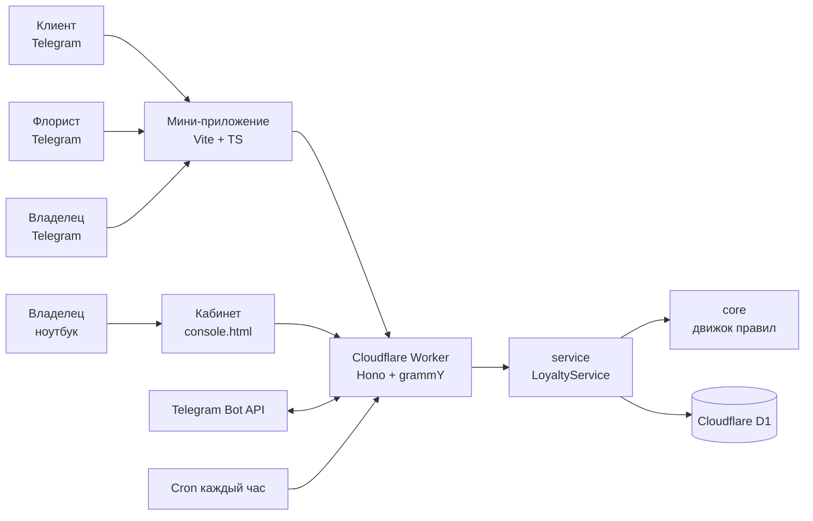
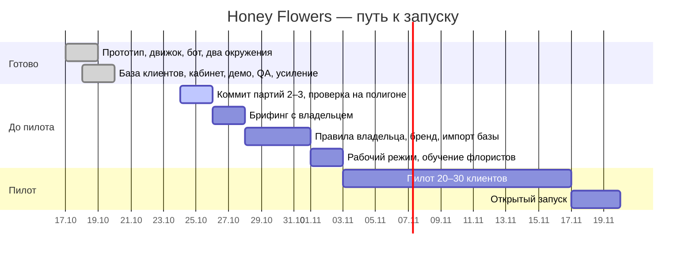
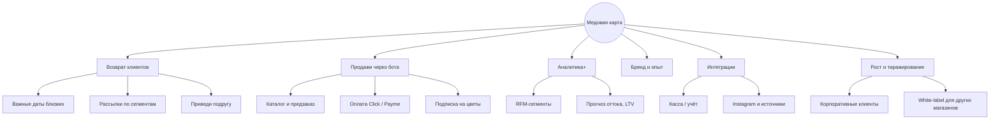

# Honey Flowers — контекст проекта

> [!summary] В двух словах
> Программа лояльности «Медовая карта» для цветочного магазина Honey Flowers (Ташкент): Telegram-бот + мини-приложение, где пчёлка открывает соты с подарками, а покупки дают «мёд» (кэшбэк 1/3/5 %). Для владельца — база клиентов, статистика и кабинет аналитики на компьютере. Всё работает на Cloudflare (бесплатный тариф), рассчитано на 1000+ клиентов. **Цель — пилот на 20–30 клиентах в начале ноября 2026.**

> [!info] Как пользоваться этим файлом
> Это общая «точка входа» для нас и для Claude. Перед любой новой сессией — прочитать **«Текущее состояние»** и **«Следующие шаги»**. После каждого заметного шага — обновить их и дописать строку в **«Журнал»** внизу. Секреты (токены, ключи) сюда **не пишем никогда** — файл лежит в репозитории.

---

## Текущее состояние

*Снимок на 24.10.2026.*

| Что | Состояние |
| --- | --- |
| Код (у Claude) | Всё сделанное собрано и проверено: 347 автотестов, полный QA-прогон без падений |
| Папка на ноутбуке | Лежат **все три партии** изменений, но закоммичена только первая (база клиентов, 18.10). Партии 2 и 3 **ещё не закоммичены** |
| Полигон `dev` (@honeyflowers_test_bot) | Работает версия с первой партией: база клиентов у владельца |
| Версия заказчика `main` (@honeyflowers_uz_bot) | Работает ранняя версия (до базы клиентов), тестовый режим открыт всем |
| Брифинг с владельцем | Подготовлен документ-сценарий; дата и итоги — *вписать* |
| Пилот | Цель — начало ноября |

> [!warning] Важно перед слиянием `dev` → `main`
> После третьей партии тестовые функции у заказчика доступны **только тем, кто в `TEST_USERS`**. Пустой список = тестовый режим выключен у всех, и Велимира потеряет переключение ролей. Сначала вписать ID в переменную сборки `TEST_USERS` у Worker'а `honeyflowers`, потом сливать.

### Следующие шаги

- [ ] Закоммитить и запушить в `dev` партии 2 и 3 (они уже в папке): `git add -A`, `git commit`, `git push`
- [ ] После деплоя проверить полигон: `/health`, журнал ночных запусков (`lastCron`) — подтвердить, что ежечасная задача укладывается в лимиты Cloudflare
- [ ] Включить тревоги: свой Telegram ID → `ALERT_CHAT_ID` (переменная сборки)
- [ ] Собрать ID/номера тестировщиков (мы, Велимира, флористы) → `TEST_USERS` у `honeyflowers`
- [ ] Слить `dev` → `main`, проверить бот заказчика
- [ ] Провести брифинг по документу [[#Документы и ссылки|«Брифинг с владельцем»]], записать решения в [[#Журнал решений]]
- [ ] Внести решения владельца в правила, перевести заказчика в рабочий режим, обучить флористов, запустить пилот

---

## Люди и каналы

- **Заказчик:** цветочный магазин Honey Flowers, Ташкент. Контакт по проекту — **Велимира**.
- **Каналы магазина:** t.me/honey_flowers_uz, t.me/honey_cards, Instagram honey.flowers.uz; заказы через @honey_uz.
- **Мы:** аккаунт общий; разработку ведём вместе с Claude.

---

## Окружения

| | Полигон (наш) | Версия заказчика |
| --- | --- | --- |
| Ветка git | `dev` | `main` |
| Бот | @honeyflowers_test_bot | @honeyflowers_uz_bot |
| Worker Cloudflare | `honey-loyalty` | `honeyflowers` |
| База D1 | `honey-loyalty` | `honey-loyalty-client` (ID в переменной сборки `CLIENT_D1_ID`) |
| Адрес | honey-loyalty.yuldashevbaburbob.workers.dev | honeyflowers.yuldashevbaburbob.workers.dev |
| Тестовый режим | открыт всем (или по `TEST_USERS`) | только `TEST_USERS`; в бою `TEST_MODE=0` |
| Для чего | эксперименты, демо-данные, показ | реальные клиенты |

Какой Worker собирается, решает скрипт `apps/worker/scripts/select-env.mjs` по ветке. Миграции базы применяются автоматически при деплое.

---

## Как мы работаем

1. Claude пишет изменения прямо в папку на ноутбуке `D:\c disk\Desktop\Honey_flowers`. Перед записью сверяет, что файлы не менялись с прошлого раза.
2. **Коммиты и пуши делаем только мы сами**, из терминала. Claude в GitHub **не пушит никогда**.
3. Порядок: `dev` → проверка в @honeyflowers_test_bot → `git checkout main && git merge dev && git push && git checkout dev`.
4. Cloudflare сам собирает и деплоит после пуша (2–3 минуты).
5. Секреты (`BOT_TOKEN`, `WEBHOOK_SECRET`, `SETUP_KEY`, `TEST_KEY`) живут только в панели Cloudflare — не в коде, не в чате, не в этом файле.

---

## Архитектура

| Пакет | Что внутри |
| --- | --- |
| `packages/core` | Чистый движок правил: соты, уровни, мёд, сгорание, отмены, подарки, версии правил |
| `packages/service` | Сервисный слой, интерфейс хранилища, проверка входа из Telegram, уведомления |
| `packages/contracts` | Типы запросов/ответов между сервером и приложением |
| `apps/worker` | Сервер: маршруты, бот, ночная задача, база D1, миграции 0001–0010 |
| `apps/miniapp` | Мини-приложение Telegram + кабинет владельца (`console.html`) |
| `qa/` | Независимый набор проверок: сценарии, нагрузка, одновременные нажатия, кривой ввод |
| `docs/DEPLOY.md` | Как разворачивать, переменные, переход в рабочий режим |

Дизайн меняется одним блоком (`config/themes.ts`), тексты — в `config/texts.ts` (ru/uz), правила — в базе и редактируются владельцем.

---

## Что реализовано

### Клиент
- [x] Регистрация в боте по номеру телефона, «Медовая карта» в мини-приложении
- [x] Соты с пчёлкой и анимацией, сюрприз-подарки в ячейках
- [x] Мёд (кэшбэк по уровням), уровни, история, QR-код
- [x] Сообщения от бота: начисление, подарок, «мёд скоро сгорит» (только 9:00–21:00)
- [x] Русский и узбекский (черновой перевод)

### Флорист
- [x] Касса: поиск клиента по номеру или QR, начисление, оплата мёдом, выдача подарка
- [x] Защита от двойного нажатия (одна покупка = одно начисление)
- [x] Отмена покупки: только в течение 24 ч и только пока мёд не потрачен и подарок не использован
- [x] «Моя карта» — сотрудник тоже клиент, но не может провести покупку на себя

### Владелец (в приложении)
- [x] Статистика + команда `/stats` в боте
- [x] База клиентов: поиск, фильтры (активные / засыпают / ушли / мёд скоро сгорит), сортировки
- [x] Карточка клиента: история, заметка, ручная корректировка мёда с причиной
- [x] Подарок или мёд без покупки с поводом
- [x] Редактор правил (проценты, пороги, подарки в сотах, сгорание, срок отмены)
- [x] Команда (сотрудники), журнал операций, выгрузка в Excel (CSV)

### Владелец (кабинет на компьютере)
- [x] Вход по одноразовой ссылке из бота, сессия 12 ч
- [x] Обзор с графиками и сравнением с прошлым периодом
- [x] Клиенты и покупки с фильтрами (период, сумма заказа, уровень, статус), выгрузка в Excel
- [x] Удержание по месяцам (когорты)
- [x] Импорт старой базы из Excel/CSV с предпросмотром и отменой; клиент из базы, зайдя в бота, получает свою карту

### Надёжность и сопровождение
- [x] Ночная задача каждый час: напоминания и сгорание, очередь сообщений с повторами
- [x] Тревоги о сбоях в Telegram (`ALERT_CHAT_ID`) — встроены, нужно включить
- [x] Дневные итоги для статистики (быстро на любой базе)
- [x] Тестовый режим: роли, тестовые часы, демо-данные (250 клиентов одной кнопкой) — только по списку `TEST_USERS`
- [x] Два окружения, автодеплой, миграции при деплое

---

## Правила программы (текущие значения)

> [!note] Это черновик до решений владельца. Меняется в приложении: Владелец → «Правила».

| Правило | Сейчас |
| --- | --- |
| Уровни и кэшбэк | Пчёлка 1 % (с 0) · Медовая 3 % (с 2 000 000 сум) · Королева улья 5 % (с 6 000 000 сум) |
| Уровень считается | по сумме покупок за всё время |
| Оплата мёдом | до 50 % заказа; скидку 10 % и мёд в одном заказе совмещать нельзя |
| Сота засчитывается | покупка от 100 000 сум, не больше одной соты в день |
| Подарки в сотах | 3 — открытка, 6 — бесплатная доставка, 10 — скидка 10 %; потом новый круг |
| Мёд начисляется на | цветы, открытки, свадебное; на доставку — нет |
| Сгорание | через 90 дней без покупок; напоминания за 14, 7 и 1 день; сгорает только мёд |
| Приветственный бонус | нет (0) |
| День рождения | выключено (дни рождения пока не спрашиваем) |
| Отмена покупки | 24 ч, только если мёд не потрачен и подарок не использован |
| 1 мёд | = 1 сум |

---

## Журнал решений

| Дата | Решение | Кто |
| --- | --- | --- |
| 17.10.2026 | Приложение (Telegram Mini App) важнее сайта; дизайн меняется одним блоком | мы |
| 17.10.2026 | Делаем параллельно, не дожидаясь всех ответов заказчика | мы |
| 18.10.2026 | Глубокая аналитика — не в приложении, а на отдельной странице с фильтрами (период, клиенты, сумма заказа) | мы |
| 18.10.2026 | Рассчитываем на 1000+ клиентов; надёжность и скорость важнее всего | мы |
| 18.10.2026 | Два окружения: полигон `dev` и версия заказчика `main` | мы |
| 18.10.2026 | Claude пишет в папку, коммиты и пуши — только мы | мы |
| 18.10.2026 | Флориста и менеджера пока не разделяем | мы |
| 19.10.2026 | Бонусы только после оплаты. Отмена — нештатная операция флориста для исправления ошибки; возврат денег не превращает мёд в деньги | мы |
| 19.10.2026 | Отмена: 24 ч, нельзя если мёд потрачен или подарок использован | мы |
| | *решения брифинга — вписать* | владелец |

---

## Открытые вопросы к владельцу

Полный список с колонкой для ответов — в документе «Брифинг с владельцем».

- [ ] Проценты и пороги уровней; считать уровень по полной сумме или за вычетом оплаты мёдом
- [ ] Потолок оплаты мёдом (сейчас 50 %)
- [ ] Порог для соты (сейчас 100 000 сум) и подарки по ячейкам
- [ ] Приветственный бонус: нужен ли и сколько
- [ ] Спрашивать ли день рождения, подарок к ДР
- [ ] Можно ли вручную уводить мёд ниже нуля (сейчас можно с предупреждением)
- [ ] Старая база: есть ли, формат, переносить ли бонусы и с какой даты они сгорают, учитывать ли прошлые покупки для уровня
- [ ] Согласие клиентов старой базы на сообщения
- [ ] Флористы: имена и номера; кто ещё видит базу
- [ ] Логотип, цвета, названия уровней; кто проверит узбекский
- [ ] Дата пилота и состав 20–30 клиентов

---

## Качество и надёжность

- **Автотесты:** 347 (движок 117, сервис 23, api 13, сервер 194), плюс сквозные прогоны приложения 49/49 и 35/35.
- **Независимый QA** (`npm run qa`): 90+ сценариев с точными цифрами, сверка «баланс = сумма операций» после каждого шага, 3000 случайных операций, 20 одновременных нажатий, ~8000 запросов с кривым вводом, нагрузка 2000 клиентов / 20 000 операций — **0 падений**.
- **Скорость:** статистика владельца читает 13 строк вместо 90 000; клиент с 1000 покупок открывается так же быстро, как новый.

> [!warning] Известные ограничения
> - Не подтверждено, считает ли Cloudflare пачку записей в базу за одно обращение (лимит 50 на бесплатном тарифе). Проверить по `lastCron` на полигоне; если упирается — уменьшить `CRON_MAX_CLIENTS`.
> - Telegram-сообщения: до ~25 за запуск, ~300 в день. Массовое сгорание у 2000 клиентов разошлётся за несколько дней.
> - Тестовые часы общие для всех на одном Worker'е.
> - Выгрузка всех операций за всю историю тяжёлая (до 150 тыс. строк чтения) — для частого использования брать период.

---

## Дорожная карта

*Даты после 24.10 — ориентир, уточнить после брифинга.*

### Этап 1. До пилота
- [ ] Партии 2–3 в `dev`, проверка полигона, включить тревоги
- [ ] Брифинг: решения по правилам, база, флористы, бренд
- [ ] Правила владельца в системе; фирменная тема, если пришли логотип и цвета
- [ ] Импорт старой базы: пробный прогон на полигоне → настоящий у заказчика
- [ ] `TEST_MODE=0`, владелец через `/setup`, флористы в «Команде»
- [ ] Памятка для флориста на одну страницу, обучение 30 минут

### Этап 2. Пилот (≈2 недели)
- [ ] 20–30 клиентов; каждый день смотрим журнал и тревоги
- [ ] Разбор нештатных случаев, быстрые правки
- [ ] Собрать отзывы флористов и клиентов

### Этап 3. Открытый запуск
- [ ] Пост в каналах и Instagram, QR на кассе и на открытках
- [ ] Наблюдение за нагрузкой и лимитами бесплатного тарифа

---

## Ветви развития

Возможные направления после запуска. Ни одно не начато — выбираем вместе с владельцем по результатам пилота.

| Ветвь | Что | Зачем магазину | Когда / условие |
| --- | --- | --- | --- |
| Важные даты близких | Клиент сохраняет ДР мамы, годовщину — бот напоминает за 3 дня с предложением букета | Прямые повторные продажи, главный повод покупать цветы | Сразу после пилота; самая «цветочная» идея |
| Рассылки по сегментам | Сообщения «засыпающим», к 14 февраля, 8 марта, Дню учителя | Возврат ушедших, пики продаж | После согласия клиентов на сообщения |
| Приведи подругу | Мёд обоим за первую покупку приглашённого | Дешёвое привлечение | Когда база > 300 клиентов |
| День рождения клиента | Спросить ДР, подарок/скидка в окне ±3 дня (заготовка в правилах уже есть) | Лояльность, повод прийти | Решение владельца на брифинге |
| Каталог и предзаказ в боте | Витрина букетов, заказ на дату, статус доставки | Заказы без переписки с @honey_uz | Большая ветвь; после стабилизации пилота |
| Оплата в боте | Click / Payme, мёд списывается автоматически | Меньше ручной работы флориста | Вместе с каталогом |
| Подписка на цветы | Букет каждую неделю/месяц, домой или в офис | Предсказуемая выручка | После каталога |
| Корпоративные клиенты | Офисы, подписки, отдельные условия | Крупные чеки | По запросу владельца |
| Аналитика+ | RFM-сегменты, прогноз оттока, LTV, эффективность акций | Решения на цифрах, а не на ощущениях | Когда накопится 2–3 месяца данных |
| Интеграция с кассой / учётом | Начисление мёда автоматически по чеку | Ноль ручного ввода, меньше ошибок | Если у магазина есть система с API |
| Instagram и источники | Ссылки/QR с метками, отчёт «откуда пришёл клиент» | Понимать, что работает в маркетинге | Лёгкая ветвь, можно в любой момент |
| Отзывы и NPS | Вопрос после покупки «как вам букет?» | Качество и отзывы в соцсетях | После пилота |
| Бренд и опыт | Фирменная тема, новые анимации, стикеры с пчёлкой | Узнаваемость, «вау» | Как только придут логотип и цвета |
| Инфраструктура | Платный Cloudflare ($5/мес) при росте, свой домен, резервные копии базы | Запас по лимитам и надёжность | При 1000+ активных клиентов или упоре в лимиты |
| Юридическое | Политика конфиденциальности, согласие на персональные данные, правила программы (оферта) | Соответствие закону РУз о персональных данных | До открытого запуска |
| White-label | Тиражировать для других цветочных магазинов, кафе, салонов (дизайн и правила уже настраиваемые) | Отдельный бизнес для нас | После успешного запуска Honey Flowers |

---

## Документы и ссылки

- Репозиторий: github.com/Mira-creators/honey_flowers-loyalty
- `README.md` — устройство проекта; `docs/DEPLOY.md` — развёртывание, переменные, рабочий режим
- Анкета для заказчика: `Honey_Flowers_loyalty_brief.docx` (27 вопросов)
- Гайд для тестирования: `Honey_Flowers_test_guide.docx` (для Велимиры)
- Документ «Брифинг с владельцем Honey Flowers»: https://claude.ai/code/artifact/652475cd-f1b5-48fa-94ef-b6d6d178650d
- План на месяц: https://claude.ai/code/artifact/ac8bb800-1c7a-448c-b19a-92b4bcbf0506
- Отчёт аудита: https://claude.ai/code/artifact/863aafa9-3326-48e5-95c9-4ef2f6726a11
- Первый прототип: https://claude.ai/artifact/8KJ1hgNJHcjsdeNiC9bsu6

---

## Журнал

- **2026-10-17** — Старт. Анкета для заказчика, план на месяц, прототип. Монорепозиторий: движок правил, сервис, Cloudflare Worker, бот, мини-приложение. Полный аудит (46 замечаний исправлено).
- **2026-10-18** — Разделили окружения: полигон `dev` и версия заказчика `main` с отдельными ботами и базами. Гайд для тестирования. База клиентов у владельца (партия 1, закоммичена). Кабинет на компьютере, импорт базы, демо-данные, тревоги, подарки без покупки, «Моя карта» (партия 2). Независимый QA: 5 ошибок найдено и исправлено.
- **2026-10-19** — Усиление (партия 3): `TEST_USERS`, ежечасная ночная задача с очередью сообщений, дневные итоги статистики, быстрые карточки тяжёлых клиентов, правило отмены 24 ч. Документ «Брифинг с владельцем». Партии 2–3 записаны в папку, не закоммичены.
- **2026-10-24** — Этот файл контекста.
