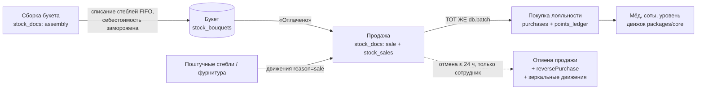
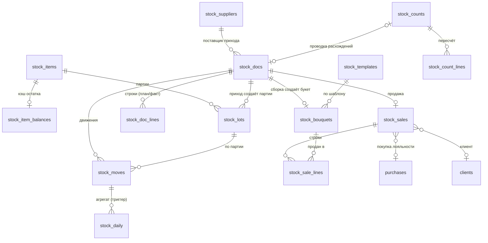
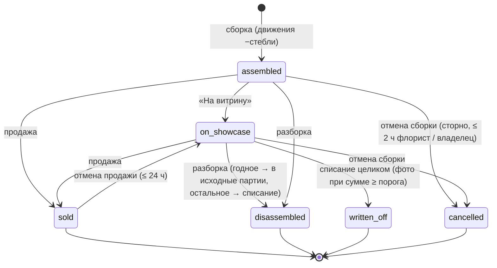
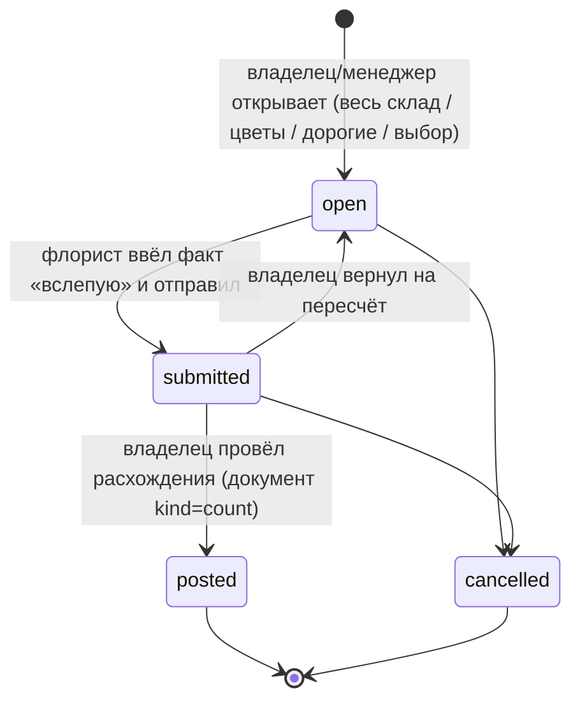
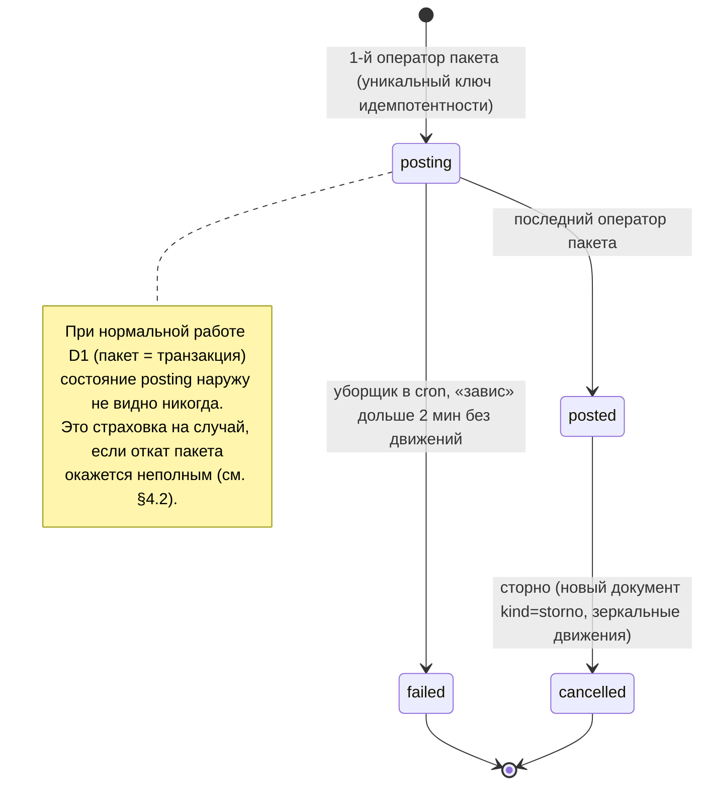
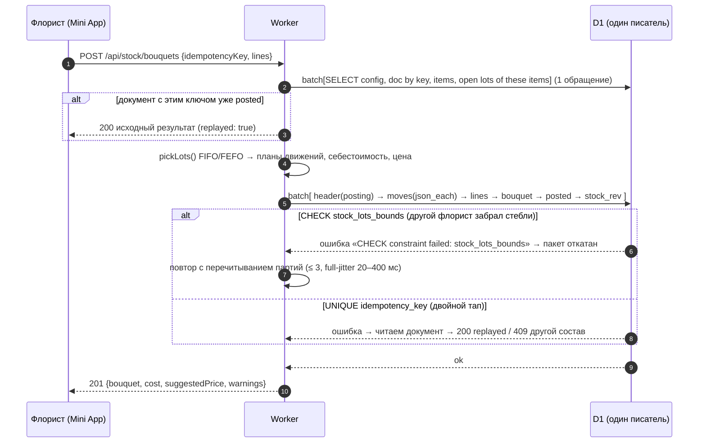
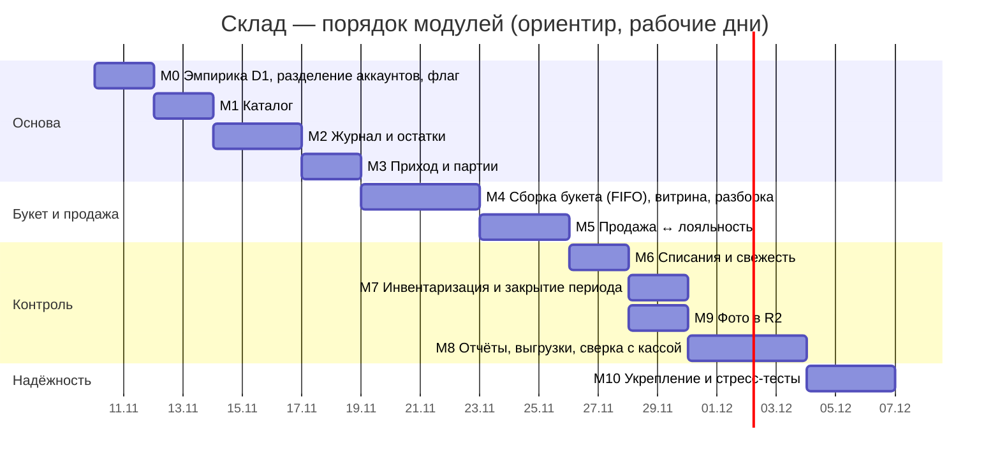

# Склад — архитектура

> [!summary] В двух словах
> Модуль «Склад» добавляется в ту же систему Honey Flowers: тот же Worker, та же база D1, то же мини-приложение и кабинет. Владелец вносит **приход** (количество и цену за цветок). Каждая строка прихода становится **партией**. Флорист в конструкторе **букета** нажимает «+» на плитках сортов. Сервер сам берёт самые старые подходящие партии (FIFO/FEFO), списывает стебли и **замораживает себестоимость** букета. Продажа букета создаёт покупку в программе лояльности **в той же транзакции**: мёд начисляется только при оплате. Вся история хранится в **неизменяемом журнале движений** `stock_moves`. Остатки в `stock_lots` и `stock_item_balances` — это кэш, его ведут триггеры, и его всегда можно пересобрать из журнала. Отрицательный остаток невозможен на уровне базы: это `CHECK`, а не проверка в коде.

> [!tip] Главные решения (коротко)
> 1. **Страж остатка — ограничение базы, а не `meta.changes`.** `CHECK (qty_on_hand BETWEEN 0 AND qty_received)` на партии плюс триггер на журнале. Перерасход обрывает оператор, а значит и весь пакет. `meta.changes` в пакете становится известен только после коммита, поэтому остановить следующие операторы он не может.
> 2. **Все движения документа вставляются одним оператором** (`INSERT … SELECT FROM json_each(?)`). SQLite откатывает оператор целиком вместе с триггерами. Поэтому согласованность «журнал = остатки» не зависит от того, как D1 откатывает `batch()`.
> 3. **Деньги:** документы, цены и себестоимость букета хранятся в целых сумах. Цена единицы в партии хранится в **милли-сумах** (`*_mu`, целые). Так FIFO сохраняет стоимость точно: лента по 4,8 сум/см не теряет копейки. **Количества** — целые базовые единицы: стебель, штука, сантиметр, лист, грамм.
> 4. **Продажа + мёд — один `db.batch`:** операторы лояльности (`outcomeStmts`) и склада вместе. Либо проходят оба, либо ни один.
> 5. **Отрицательный остаток** по умолчанию разрешён с подтверждением и комментарием и уходит на «дефицитную партию». Следующий приход гасит её автоматически, разница цены видна в отчёте. Режим настраивается: `block` / `warn` / `allow`.
> 6. **Продакшн выносится в отдельный аккаунт Cloudflare магазина на Workers Paid ($5/мес)** до запуска склада, крайний срок — до 1 февраля 2027. В пик 8 марта склад и лояльность вместе съедают **до ~75% бесплатной суточной квоты записей**, а при её исчерпании база блокируется до 05:00.

> [!warning] Что нужно сделать до первой строки кода
> - **M0:** эмпирические проверки D1 на настоящем Cloudflare (откат пакета, лимиты операторов и запросов, подсчёт строк от триггеров, `json_each` с большим параметром). Без зелёного M0 не начинаем M4–M5.
> - Разделить аккаунты: продакшн в отдельном аккаунте, оформленном на магазин.
> - Модуль включается флагом `STOCK_ENABLED`, поэтому слияние `dev → main` ничего не открывает заказчику раньше времени.

---

## 1. Цели и границы

### 1.1 Что модуль делает на запуске

| # | Возможность | Кто | Где |
|---|---|---|---|
| 1 | Справочник позиций: цветы, зелень, фурнитура, услуги. Базовая единица, пачка, срок жизни, фото, ИКПУ | владелец | приложение + кабинет |
| 2 | **Приход**: поставщик, дата, строки «сорт · количество (пачки/стебли) · цена за стебль или пачку», необязательно валюта и курс, накладные (доставка, таможня) с распределением | владелец (+ менеджер по настройке) | приложение, кабинет (удобнее для длинных накладных) |
| 3 | **Сборка букета**: плитки с фото, «+/−», шаблон по желанию, живые себестоимость, цена и доля себестоимости против 33% / 25% | флорист | приложение |
| 4 | Автосписание компонентов **при сборке** по FIFO/FEFO, заморозка себестоимости | сервер | — |
| 5 | Букет «под заказ» сразу продаётся, букет «на витрину» живёт как единица товара. **Разборка** непроданного: годное возвращается в исходные партии, остальное списывается | флорист | приложение |
| 6 | **Продажа**: букеты, поштучные стебли, услуги. Необязательная привязка к клиенту лояльности, оплата мёдом по правилам, способ оплаты | флорист | приложение (касса) |
| 7 | **Списание** с причиной, фото и порогом подтверждения владельцем | флорист → владелец | приложение |
| 8 | **Экран свежести**: партии, у которых подходит или прошёл срок, и «деньги под риском» | флорист, владелец | приложение |
| 9 | **Слепая инвентаризация**, корректировки, закрытие периода | флорист считает, владелец проводит | приложение + кабинет |
| 10 | Отчёты с фильтрами и выгрузкой: маржа, усушка, стоимость остатка, расход по факту и по нормам, история закупочных цен | владелец | **только кабинет** |

### 1.2 Чего модуль явно НЕ делает (на запуске)

| Не делаем | Почему | Задел в схеме |
|---|---|---|
| Несколько магазинов и складов, перемещения | один магазин (вопрос 17) | `location_id INTEGER DEFAULT 1` в партиях и движениях |
| Интеграция с онлайн-кассой и фискализация | нет ответа владельца (вопрос 15). Наш модуль — не касса, чеков не печатает | поле `ikpu` у позиций, `category` в строках продажи |
| Онлайн-оплата (Click/Payme) | отдельная ветвь «Продажи через бота» | `payment_method` |
| Заказы на дату, резервы, доставка с курьером | отдельная ветвь | `kind = 'order'` у букета |
| Автоматическое списание без подтверждения | скрывает причины потерь (вывод отчёта) | экран свежести *предлагает*, человек подтверждает |
| Перепроведение FIFO задним числом | дорого и меняет замороженные цены. Задним числом можно провести максимум 3 дня и только владельцу | `doc_date` + закрытие периода |
| Зарплата и бонусы флористов | вне учёта склада | отчёт по флористам даёт данные |
| Офлайн-режим | Telegram Mini App без сети не работает | бумажный бланк + ввод задним числом (§9) |
| Реплики чтения D1 | бета, а устаревшие остатки вредны | — |

### 1.3 Связь с лояльностью



Правила, которые **не меняются**, а распространяются на склад:

- **Мёд только после оплаты.** Продажа создаётся кнопкой «Оплачено». Сборка букета мёд не начисляет никогда. Покупка лояльности получает ключ идемпотентности `sale:<saleId>`. Её строки по категориям (`flowers`, `cards`, `delivery`, `wedding`) берутся из строк продажи, поэтому доставка мёда не даёт, как требуют действующие правила.
- **Отмена — нештатная операция сотрудника** в окне `reversalWindowHours` (сейчас 24 ч). Действуют те же блокировки: мёд потрачен, подарок использован. Отмена продажи откатывает покупку лояльности и складскую часть **одним пакетом**. Если лояльность отмену запрещает, отменить складскую часть отдельно может только владелец (флажок «без отмены мёда» + причина).
- **Деньги мёдом не возвращаются.** Возврат денег клиенту — вне системы, как и раньше.
- Продажа без клиента лояльности (анонимный покупатель) — обычный случай: 30–50% покупателей цветов в карту не попадут.
- Сотрудник не проводит продажу с мёдом на свою карту: используется существующий `assertNotOwnCard`.

---

## 2. Предметная модель

### 2.1 Сущности



| Сущность | Смысл | Изменяемость |
|---|---|---|
| **Позиция** (`stock_items`) | Сорт или вещь: «Роза Red Naomi 60 см», «Лента атласная 2,5 см», «Доставка» | правится владельцем, версия для оптимистичной правки, история в `audit_log` |
| **Поставщик** | имя, телефон, заметка | правится |
| **Документ** (`stock_docs`) | приход, сборка, продажа, списание, разборка, инвентаризация, возврат поставщику, сторно | заголовок меняет только статус и подтверждение (триггер переходов) |
| **Партия** (`stock_lots`) | одна строка прихода: дата, срок, количество, **цена единицы**. Ещё бывают служебные партии `deficit` (продано в минус) и `surplus` (излишек по инвентаризации) | цена, количество прихода и дата **неизменяемы** (триггер). `qty_on_hand` — кэш |
| **Движение** (`stock_moves`) | знаковое количество по партии со стоимостью и причиной | **только вставка** (триггеры запрещают UPDATE и DELETE) |
| **Букет** (`stock_bouquets`) | единица товара с замороженной себестоимостью | статус по автомату переходов, себестоимость заморожена |
| **Продажа** (`stock_sales`) | оплата, клиент, связь с покупкой лояльности | статус `paid → reversed` |
| **Инвентаризация** (`stock_counts`) | слепой пересчёт → расхождения → корректировка | статусы |

### 2.2 Справочник позиций

| Поле | Значение и правило |
|---|---|
| `kind` | `flower` · `greenery` · `supply` · `service`. Услуги (доставка, работа) не имеют остатка и партий |
| `base_unit` | `stem` (стебель) · `pcs` · `cm` · `sheet` · `g`. **Все количества в базе хранятся в базовых единицах, целыми** |
| `display_unit` + `display_factor` | как показывать: лента хранится в `cm`, показывается в метрах (`factor = 100`). Ввод «2,5 м» → 250 |
| `pack_name` + `pack_size` | «пачка = 25 стеблей». Приход вводится пачками или стеблями, в базу пишутся стебли |
| `vase_life_days` | сколько цветок живёт у покупателя (вопрос 20) |
| `sell_days` | сколько дней держим в магазине до «старый — в букет первым». `sell_by = дата прихода + sell_days` |
| `warn_days` | за сколько дней до `sell_by` подсвечивать жёлтым |
| `track_stock` | `1` — вести остаток. `0` — расходник без учёта (например, скотч): в букете считается по `std_cost_mu`, движений не создаёт (вопрос 8) |
| `markup_x100` | свой множитель цены для позиции (300 = 3,0×), иначе по виду из настроек |
| `loose_price_uzs` | цена за единицу при продаже поштучно |
| `ikpu` | 17 цифр (формат проверить у бухгалтера магазина). Необязательное, для будущей кассы |
| `photo_key` | фото сорта из магазина в R2 (своё, а не каталожное: жалоба на Details и Curate в отчёте) |

> [!note] Почему целые базовые единицы, а не дробные
> SQLite хранит целые точно, а `REAL` даёт `0,1 + 0,2 ≠ 0,3`. Для цветов дробей нет: стебель целый. Дробность ленты и бумаги снимается выбором мелкой базовой единицы: сантиметр, лист, грамм. Фиксированная точка `qty × 1000` для всех позиций усложнила бы каждое место (ввод, вывод, отчёты, CHECK) ради двух видов фурнитуры. Предел: 1 000 000 базовых единиц в строке (10 км ленты), с запасом.

### 2.3 Приход → партии

1. Владелец создаёт приход: поставщик (необязательно), учётная дата (сегодня, задним числом до 3 дней), **валюта прихода — переключатель «сум / доллар» в окне прихода** (по умолчанию сум) и курс, если доллар, накладные расходы в сумах. Решение 07.11: даже если поставку оплатили вперемешку, владелец приводит её к **одной валюте** сам — так проще и в статистике не путаться.
2. Цены можно ввести двумя способами (переключатель в окне):
   - **Построчно:** у каждой строки сорт, количество в пачках или единицах и цена **за единицу, за пачку или за всю строку**.
   - **Одной суммой за всю поставку:** у строк только сорт и количество, а владелец вводит общую сумму поставки. Сервер распределяет её по строкам **пропорционально опорной цене** сорта (цена последнего прихода этого сорта; если истории нет — `std_cost_mu` из карточки; если нет и её — поровну на единицу). Предпросмотр показывает получившуюся цену стебля по каждой строке, и любую из них можно поправить вручную — тогда остаток суммы перераспределяется по остальным строкам.
   Итог в обоих способах один: цена базовой единицы в сумах у каждой строки.
3. **Внутри системы всё в сумах.** Валюта прихода нужна только на входе: долларовые цены × курс прихода = сумы. Все отчёты, себестоимость и статистика — в сумах; в отчёте «закупочные цены» дополнительно видны исходная валюта и курс.

> [!example] Пачка → стебли (подтверждено владельцем 07.11)
> Цветы покупают пачками, продают поштучно. Пачка 30 роз за 360 000 сум → партия 30 стеблей по 12 000. Из неё 11 уходят в один букет, 1 — в композицию, 3 — в другой букет: каждая сборка списывает свои стебли из той же партии, остаток партии 15. Пачка — только способ ввода; учёт всегда в стеблях.
4. **Накладные** (доставка, таможня) распределяются по строкам пропорционально стоимости строки, остаток округления уходит методом наибольшего остатка. Распределённое входит в цену единицы (IAS 2: затраты на доставку — часть себестоимости запасов).
5. **Курс** фиксируется на дату прихода и позже не переоценивается (IAS 21). Исходная цена, валюта и курс сохраняются в приходе и в партии для аудита. EUR схема допускает, но в интерфейсе по умолчанию скрыт.
6. Предпросмотр показывает цену стебля по каждой строке и предупреждает, если она отличается от прошлой больше чем на ±30% (защита от опечатки: «120 000 вместо 12 000»).
7. Проведение создаёт по одной партии на строку: `received_at`, `sell_by`, `expires_on`, `unit_cost_mu`, `qty_received`. Плюс приходное движение `+qty`.
8. Если по сорту висит дефицит (продавали в минус), тот же пакет гасит его: см. §4.6.

### 2.4 Журнал движений и кэши

- `stock_moves` — единственный источник правды. Каждое движение: `doc_id`, `item_id`, `lot_id`, `qty` (знаковое), `value_mu = qty × lot.unit_cost_mu` (проверяет триггер), `reason`, `doc_date`, `actor_id`, `reverses_move_id`.
- Кэши ведёт триггер `AFTER INSERT` в том же операторе:
  - `stock_lots.qty_on_hand` — остаток партии (здесь срабатывает страж `CHECK`);
  - `stock_item_balances (qty, value_mu)` — остаток и стоимость по позиции для конструктора;
  - `stock_daily (day, item_id, reason)` — дневные агрегаты для отчётов (как `stats_daily` у лояльности).
- Отмена — **зеркальное движение** с `reverses_move_id` (уникально: дважды отменить нельзя). Причина у него та же, что у исходного, поэтому агрегаты нетто сходятся сами.
- Пересборка кэшей из журнала: §4.8.

### 2.5 Сборка букета

- **Шаблон** (необязательно): «15 роз + 3 эвкалипта + крафт + лента 80 см». Выбор шаблона заполняет плановое количество (`qty_planned`), флорист правит его до факта.
- Флорист указывает только **сорт и количество**. Партии выбирает сервер:
  - порядок отбора: `priority DESC` («в букет первыми» с экрана свежести), затем `expires_on` (FEFO), затем `received_at` (FIFO), затем `id`. При одинаковом сроке жизни сорта FEFO совпадает с FIFO;
  - партия бывает частичной: 15 роз = 7 из партии от 03.11 + 8 из партии от 05.11.
- Себестоимость `cost_mu = Σ qty × unit_cost_mu` по выбранным партиям **замораживается** в букете (триггер запрещает её менять) и в сумах (`cost_uzs`, округление half-up). Отдельно хранятся «цветы + зелень» и «фурнитура» для норм 25% и 33%.
- Рекомендованная цена и назначенная цена хранятся обе, чтобы мерить скидки флористов.
- **Вид:** `order` (под заказ: дальше обычно сразу продажа) или `showcase` (на витрину).

### 2.6 Букет как единица и разборка



- Продажа витринного букета двигает **только букет**: стебли списаны ещё при сборке. Себестоимость продажи = замороженная `cost_uzs`.
- **Разборка:** флорист отмечает, сколько стеблей каждого сорта годны. Они возвращаются движением `disassembly_return` **в те же партии, из которых были взяты**, с исходной датой прихода (свежесть не «омолаживается»). Остальное уходит движением `disassembly_waste`. Сохранение стоимости: возврат + отходы = себестоимость букета. Это проверяется инвариантом.
- Переходы статусов охраняет триггер. Две операции над одним букетом (две продажи, продажа и разборка одновременно) не пройдут обе: вторая упрётся в недопустимый переход `sold → sold`.

### 2.7 Продажа

- Состав: букеты (`kind = bouquet`), поштучные позиции (`item`: стебли, открытки, ваза — движения `reason = sale` по FIFO) и услуги (`service`: доставка, без движений).
- Каждая строка несёт категорию лояльности: букет и стебли — `flowers`, открытка — `cards`, доставка — `delivery`. Покупка лояльности строится по строкам, а не одной суммой.
- `paid_uzs = total − honey_redeemed − discount` (CHECK). Способ оплаты: `cash | card | transfer | mixed`.
- Себестоимость продажи (`cost_uzs`) заморожена: сумма по букетам и поштучным движениям.

### 2.8 Списания, фото, подтверждение

| Причина (`reason`) | Что это | Входит в «усушку»? |
|---|---|---|
| `writeoff_wilt` | увядание или порча | **да** |
| `writeoff_damage` | поломка | **да** |
| `disassembly_waste` | отходы разборки витринного букета | **да** (отдельной строкой) |
| `writeoff_supplier` | брак поставщика. Флажок «вернули поставщику» и отметка в течение 24 ч | нет, это претензия |
| `writeoff_showcase` | на оформление витрины или фото | нет, маркетинг |
| `writeoff_gift` | комплимент клиенту | нет, маркетинг |
| `writeoff_rework` | переделка по жалобе | нет, качество |
| `count_shortage` / `count_surplus` | расхождение инвентаризации (только через документ инвентаризации) | нет, **сигнал воровства или ошибок учёта** |

- Списание на сумму **≥ порога** (по умолчанию 200 000 сум, вопрос 12) требует фото и получает `approval = pending`. Владельцу уходит сообщение в Telegram.
- **Проводится сразу**: стебли физически пропали, и остаток должен это отражать, иначе FIFO отдаст их в следующий букет. Подтверждение — это контроль, а не ворота. «Отклонить» = сторно (зеркальные движения) + причина + пометка в отчёте по флористу. В отчёте видно и то, что было отклонено, и то, что ещё ждёт решения.
- Экран свежести *предлагает* списать просроченные партии одной кнопкой. Каждое списание — явное действие человека.

### 2.9 Инвентаризация и закрытие периода



- **Слепо:** флорист видит список позиций, но **не видит ожидаемый остаток**. Сервер его не отдаёт, а не просто прячет на экране.
- Каждая строка запоминает `after_move_id`: номер последнего движения в журнале в момент ввода. Ожидаемое количество = текущий остаток − Σ движений позиции с `id > after_move_id`. Так продажи во время пересчёта не искажают расхождение, и закрывать магазин на инвентаризацию не нужно.
- Проводка: недостача — движения `count_shortage` по FIFO (самые старые партии; скорее всего, это и есть увядшее). Излишек — движение `count_surplus` в служебную партию `surplus` по цене последнего прихода.
- **Закрытие периода:** `settings.stock_closed_through = 'YYYY-MM-DD'`. Триггер на журнале отклоняет любое движение с `doc_date ≤` этой даты. Сторно документов закрытого периода проводится **текущей датой** («сторно текущим периодом»). Закрыть период можно только после проведённой инвентаризации (или явным «закрыть без инвентаризации» с причиной).

### 2.10 Уценка

- **Уценка букета на витрине** меняет `price_current_uzs` с причиной. Себестоимость не трогает. Запись идёт в `audit_log`.
- **Акция на партию** (`promo_pct`): поштучная цена стеблей этой партии со скидкой, и подсказка «в букет первыми». Себестоимость не трогает.
- В отчёте маржи видно: рекомендованная → назначенная → фактическая цена.

### 2.11 Политика отрицательного остатка

| Режим (`negativePolicy`) | Поведение | Когда |
|---|---|---|
| `block` | сборка или продажа больше остатка → 409 `stock_short`, ничего не пишется | когда приходы вносятся дисциплинированно |
| **`warn` (по умолчанию)** | первый запрос → 409 `stock_short` со списком нехватки. Флорист подтверждает «собрать в минус» + комментарий (≥ 3 символа) → недостающее списывается с **дефицитной партии** | пилот, праздники: «8 марта клиент не должен ждать прихода» |
| `allow` | молча в дефицит, но с пометкой в списке исключений | не рекомендуется |

Дефицитная партия: `kind = 'deficit'`, `id = 'def:<item>:<cost>'`, цена = цена последнего прихода (или `std_cost_mu`). Её `qty_on_hand ≤ 0` (CHECK). Ближайший приход гасит её автоматически (§4.6), разница цены попадает в отчёт «досписание из-за продажи в минус». Букет, собранный в минус, помечен `used_deficit = 1`. Ежедневный список исключений показывает все дефициты, пока их не закроют.

### 2.11a Сверка с кассой и с Excel

Ответ владельца 07.11: сейчас магазин ведёт **Excel-таблицу вручную** и сверяет её с **кассой** (система, через которую идут налоги). В идеале обе должны совпадать. Отсюда требования к нашему модулю:

- **Наша система заменяет ручной Excel, а не кассу.** Касса остаётся фискальным источником для налоговой; мы чеков не печатаем.
- **Ежедневная сверка «наша система ↔ касса»** (кабинет, раздел «Сверка»): за выбранный день — итоги продаж по способам оплаты (наличные, карта, Click/Payme, мёд), число продаж, итог по категориям (букеты, поштучные стебли, упаковка, доставка) и, когда у позиций будут коды, по ИКПУ. Владелец вводит итоги из Z-отчёта кассы (или позже — импорт выгрузки кассы), система показывает расхождения построчно и список наших продаж за день, чтобы найти пропущенный чек. Отметка «день сверен» закрывает день для правок задним числом.
- **Выгрузка «как в вашем Excel»**: продажи, приходы, списания и остатки в тех же колонках, что сейчас ведёт магазин, — чтобы на переходный период можно было продолжать сверку привычным способом и сравнить две системы. Для этого нужен **образец их таблицы** (можно с вымышленными цифрами).
- **Начальные остатки и справочник** — импорт из их Excel в кабинете (уже в M1/M3).
- **Интеграция с кассой по API** — не на старте; решаем, когда узнаем, какая у них касса и есть ли у неё API.

Сверка добавлена в модуль M8 и в вопросы владельцу (21–23).

### 2.12 Жизненный цикл документа (общий)



Подтверждение списания идёт отдельной осью: `approval: none → pending → approved | rejected`. При `rejected` создаётся сторно.

---

## 3. Схема БД

Соглашения те же, что в `0001_init.sql`: id — `TEXT` (UUID из Worker'а), время — ISO-8601 UTC `TEXT`, учётные даты — `YYYY-MM-DD` по Ташкенту, деньги — `INTEGER`. Каждый индекс — это лишняя записанная строка на каждую вставку (бесплатный D1 — 100 тыс. в сутки), поэтому индексы добавляются только под конкретный запрос, и у каждого указано, зачем он.

| Миграция | Модуль | Таблицы |
|---|---|---|
| `0011_stock_catalog.sql` | M1 | `stock_items`, `stock_item_balances`, `stock_suppliers`, `stock_templates`, `audit_log`, настройки по умолчанию |
| `0012_stock_ledger.sql` | M2–M3 | `stock_docs`, `stock_doc_lines`, `stock_lots`, `stock_moves`, `stock_daily` + триггеры |
| `0013_stock_bouquets_sales.sql` | M4–M5 | `stock_bouquets`, `stock_sales`, `stock_sale_lines` |
| `0014_stock_counts.sql` | M7 | `stock_counts`, `stock_count_lines`, `stock_periods` |
| `0015_stock_photos.sql` | M9 | `stock_photos` |

> [!info] Деньги: суммы и милли-сумы
> - **Целые сумы (`*_uzs`)** — всё, что видит человек: цены, суммы документов, себестоимость букета, суммы продаж.
> - **Милли-сумы (`*_mu`, 1 сум = 1000 mu)** — только цена базовой единицы в партии и стоимость движений. Пример: лента 25 м за 12 000 сум = 4,8 сум/см = 4 800 mu/см. В целых сумах получилось бы 5 сум/см, и за рулон набежала бы ошибка 500 сум. С mu сохранение точное: Σ `value_mu` движений партии = `qty_received × unit_cost_mu`.
> - Неделимые остатки (7 стеблей за 100 000 сум → 14 285 714 mu) дают расхождение с накладной меньше 1 сума на партию. Оно пишется в `stock_doc_lines.rounding_mu`.
> - Пределы против переполнения `Number` в JS (2^53 ≈ 9·10^15): количество в строке ≤ 1 000 000, цена единицы ≤ 10^11 mu (100 млн сум). Значит, стоимость строки ≤ 10^17 — **больше 2^53**. Поэтому zod-схема дополнительно ограничивает **стоимость строки ≤ 10^15 mu** (1 трлн сум), а сервер считает в `BigInt` там, где перемножает.

### 3.1 `0011_stock_catalog.sql`

```sql
-- Склад (M1): справочник позиций, кэш остатков по позиции, поставщики, шаблоны, журнал аудита.

CREATE TABLE stock_items (
  id              TEXT PRIMARY KEY,
  sku             TEXT NOT NULL UNIQUE,                              -- короткий код на ярлыке: 'RN60'
  name            TEXT NOT NULL CHECK (length(trim(name)) BETWEEN 1 AND 80),
  kind            TEXT NOT NULL CHECK (kind IN ('flower','greenery','supply','service')),
  grp             TEXT NOT NULL DEFAULT '',                          -- группа плиток: 'Розы', 'Упаковка'
  base_unit       TEXT NOT NULL CHECK (base_unit IN ('stem','pcs','cm','sheet','g')),
  display_unit    TEXT NOT NULL,                                     -- 'шт', 'м', 'лист'
  display_factor  INTEGER NOT NULL DEFAULT 1 CHECK (display_factor >= 1),
  pack_name       TEXT,
  pack_size       INTEGER CHECK (pack_size IS NULL OR pack_size BETWEEN 1 AND 100000),
  vase_life_days  INTEGER CHECK (vase_life_days IS NULL OR vase_life_days BETWEEN 1 AND 365),
  sell_days       INTEGER CHECK (sell_days IS NULL OR sell_days BETWEEN 1 AND 365),
  warn_days       INTEGER NOT NULL DEFAULT 1 CHECK (warn_days BETWEEN 0 AND 30),
  track_stock     INTEGER NOT NULL DEFAULT 1 CHECK (track_stock IN (0,1)),
  std_cost_mu     INTEGER CHECK (std_cost_mu IS NULL OR std_cost_mu >= 0),   -- для track_stock = 0 и услуг
  markup_x100     INTEGER CHECK (markup_x100 IS NULL OR markup_x100 BETWEEN 100 AND 2000),
  loose_price_uzs INTEGER CHECK (loose_price_uzs IS NULL OR loose_price_uzs > 0),
  ikpu            TEXT CHECK (ikpu IS NULL OR (length(ikpu) = 17 AND ikpu NOT GLOB '*[^0-9]*')),
  photo_key       TEXT,
  sort_order      INTEGER NOT NULL DEFAULT 0,
  active          INTEGER NOT NULL DEFAULT 1 CHECK (active IN (0,1)),
  version         INTEGER NOT NULL DEFAULT 1,                        -- правка: UPDATE … WHERE version = ?
  demo            INTEGER NOT NULL DEFAULT 0,
  created_at      TEXT NOT NULL,
  updated_at      TEXT NOT NULL,
  CONSTRAINT stock_items_service CHECK (kind <> 'service' OR (track_stock = 0 AND base_unit = 'pcs'))
);
-- Плитки конструктора: активные позиции по группам в заданном порядке (≤ 300 строк, читается целиком).
CREATE INDEX stock_items_tiles_idx ON stock_items (active, grp, sort_order);

-- Кэш Σ движений по позиции. Ведёт ТОЛЬКО триггер stock_moves_apply (0012).
CREATE TABLE stock_item_balances (
  item_id          TEXT PRIMARY KEY REFERENCES stock_items(id),
  qty              INTEGER NOT NULL DEFAULT 0,      -- < 0 возможно только из-за дефицитных партий
  value_mu         INTEGER NOT NULL DEFAULT 0,
  last_cost_mu     INTEGER,                         -- цена базовой единицы последнего прихода
  last_receipt_on  TEXT,
  updated_at       TEXT NOT NULL DEFAULT ''
) WITHOUT ROWID;

CREATE TABLE stock_suppliers (
  id          TEXT PRIMARY KEY,
  name        TEXT NOT NULL CHECK (length(trim(name)) BETWEEN 1 AND 80),
  phone       TEXT,
  note        TEXT CHECK (note IS NULL OR length(note) <= 500),
  active      INTEGER NOT NULL DEFAULT 1 CHECK (active IN (0,1)),
  created_at  TEXT NOT NULL
);

CREATE TABLE stock_templates (
  id          TEXT PRIMARY KEY,
  name        TEXT NOT NULL CHECK (length(trim(name)) BETWEEN 1 AND 60),   -- '15 роз с эвкалиптом'
  lines       TEXT NOT NULL CHECK (json_valid(lines) AND json_type(lines) = 'array' AND json_array_length(lines) BETWEEN 1 AND 40),
  price_uzs   INTEGER CHECK (price_uzs IS NULL OR price_uzs > 0),           -- фиксированная цена шаблона (если владелец так решил)
  active      INTEGER NOT NULL DEFAULT 1 CHECK (active IN (0,1)),
  sort_order  INTEGER NOT NULL DEFAULT 0,
  created_at  TEXT NOT NULL,
  updated_at  TEXT NOT NULL
);

-- Аудит изменений, которые НЕ являются документами склада: карточки, настройки, подтверждения,
-- закрытие периода, уценки, выгрузки, пересборка кэшей. Документы и движения аудируют себя сами.
CREATE TABLE audit_log (
  id          INTEGER PRIMARY KEY AUTOINCREMENT,
  at          TEXT NOT NULL,
  actor_id    TEXT NOT NULL,
  actor_role  TEXT NOT NULL,
  action      TEXT NOT NULL,          -- 'stock.item.update', 'stock.config.update', 'stock.approval', 'stock.markdown', 'stock.period.close', 'export', 'stock.rebuild'
  entity      TEXT NOT NULL,
  entity_id   TEXT,
  details     TEXT CHECK (details IS NULL OR (json_valid(details) AND length(details) <= 4000))   -- {before, after} / параметры
);
CREATE INDEX audit_log_at_idx ON audit_log (at);
CREATE INDEX audit_log_entity_idx ON audit_log (entity, entity_id);
CREATE TRIGGER audit_log_no_update BEFORE UPDATE ON audit_log
BEGIN SELECT RAISE(ABORT, 'audit_log: только дополняется'); END;
CREATE TRIGGER audit_log_no_delete BEFORE DELETE ON audit_log
WHEN NOT EXISTS (SELECT 1 FROM maintenance WHERE flag = 'allow_stock_delete')
BEGIN SELECT RAISE(ABORT, 'audit_log: только дополняется'); END;

-- Настройки склада: один JSON, проверяется zod-схемой StockConfig (packages/stock/config.ts).
-- stock_rev: счётчик изменений остатков (ETag конструктора), +1 в каждом пакете проводки.
INSERT OR IGNORE INTO settings (key, value) VALUES
  ('stock_config', '{}'), ('stock_closed_through', '0000-00-00'), ('stock_rev', '0'), ('stock_catalog_rev', '0');
```

### 3.2 `0012_stock_ledger.sql`

```sql
-- Склад (M2–M3): документы, партии, неизменяемый журнал движений, дневные агрегаты.

CREATE TABLE stock_docs (
  id               TEXT PRIMARY KEY,
  kind             TEXT NOT NULL CHECK (kind IN ('receipt','assembly','sale','writeoff','disassembly','count','return','storno')),
  number           INTEGER NOT NULL,                     -- «Приход №12»: MAX(number)+1 внутри вида, в том же операторе
  status           TEXT NOT NULL CHECK (status IN ('posting','posted','cancelled','failed')),
  doc_date         TEXT NOT NULL CHECK (doc_date GLOB '[0-9][0-9][0-9][0-9]-[0-9][0-9]-[0-9][0-9]'),
  idempotency_key  TEXT NOT NULL UNIQUE,
  payload_hash     TEXT NOT NULL,                        -- SHA-256 нормализованного запроса: тот же ключ + другой состав = 409
  actor_id         TEXT NOT NULL,                        -- staff id или 'tg:<id>' (TEST_MODE), как в purchases.staff_id
  actor_role       TEXT NOT NULL,
  supplier_id      TEXT REFERENCES stock_suppliers(id),
  cancels_doc_id   TEXT REFERENCES stock_docs(id),
  total_value_mu   INTEGER NOT NULL DEFAULT 0,           -- Σ |value_mu| движений документа (списки без JOIN)
  extra_cost_uzs   INTEGER NOT NULL DEFAULT 0 CHECK (extra_cost_uzs >= 0),
  currency         TEXT NOT NULL DEFAULT 'UZS' CHECK (currency IN ('UZS','USD','EUR')),   -- валюта прихода (одна на документ)
  fx_rate_x100     INTEGER CHECK (fx_rate_x100 IS NULL OR fx_rate_x100 > 0),             -- сумов за 1 единицу валюты × 100
  price_mode       TEXT CHECK (price_mode IS NULL OR price_mode IN ('lines','total')),    -- приход: цены построчно или одной суммой
  input_total      INTEGER CHECK (input_total IS NULL OR input_total >= 0),               -- приход «одной суммой»: сумма в валюте прихода (сумы или центы)
  approval         TEXT NOT NULL DEFAULT 'none' CHECK (approval IN ('none','pending','approved','rejected')),
  approved_by      TEXT,
  approved_at      TEXT,
  note             TEXT CHECK (note IS NULL OR length(note) <= 500),
  photo_key        TEXT,
  demo             INTEGER NOT NULL DEFAULT 0,
  created_at       TEXT NOT NULL,
  posted_at        TEXT,
  CONSTRAINT stock_docs_fx CHECK ((currency = 'UZS') = (fx_rate_x100 IS NULL)),
  CONSTRAINT stock_docs_total CHECK ((price_mode = 'total') = (input_total IS NOT NULL)),
  CONSTRAINT stock_docs_storno CHECK ((kind = 'storno') = (cancels_doc_id IS NOT NULL)),
  CONSTRAINT stock_docs_approval CHECK (approval IN ('none','pending') OR (approved_by IS NOT NULL AND approved_at IS NOT NULL))
);
CREATE UNIQUE INDEX stock_docs_number_uq   ON stock_docs (kind, number);                          -- нумерация + поиск «№12»
CREATE UNIQUE INDEX stock_docs_cancels_uq  ON stock_docs (cancels_doc_id) WHERE cancels_doc_id IS NOT NULL;  -- сторно один раз
CREATE INDEX stock_docs_date_idx           ON stock_docs (doc_date, kind);                        -- списки и отчёты за период
CREATE INDEX stock_docs_posting_idx        ON stock_docs (created_at) WHERE status = 'posting';   -- уборщик (обычно пуст)
CREATE INDEX stock_docs_pending_idx        ON stock_docs (created_at) WHERE approval = 'pending'; -- «На подтверждение»

-- Заголовок меняет только статус (по автомату) и подтверждение; ключ освобождается только при failed.
CREATE TRIGGER stock_docs_guard BEFORE UPDATE ON stock_docs
WHEN NOT (
      OLD.status = NEW.status
   OR (OLD.status = 'posting' AND NEW.status IN ('posted','failed'))
   OR (OLD.status = 'posted'  AND NEW.status = 'cancelled')
  )
  OR NEW.kind IS NOT OLD.kind OR NEW.number IS NOT OLD.number OR NEW.doc_date IS NOT OLD.doc_date
  OR NEW.actor_id IS NOT OLD.actor_id OR NEW.payload_hash IS NOT OLD.payload_hash
  OR NEW.cancels_doc_id IS NOT OLD.cancels_doc_id
  OR (NEW.idempotency_key IS NOT OLD.idempotency_key AND NEW.status <> 'failed')
  OR (OLD.status <> 'posting' AND (NEW.total_value_mu IS NOT OLD.total_value_mu OR NEW.extra_cost_uzs IS NOT OLD.extra_cost_uzs))
  -- подтверждение: только pending → approved | rejected (повторное нажатие → ABORT → 409 «Уже подтверждено»)
  OR (NEW.approval IS NOT OLD.approval AND NOT (OLD.approval = 'pending' AND NEW.approval IN ('approved','rejected')))
BEGIN SELECT RAISE(ABORT, 'stock: недопустимое изменение документа'); END;
CREATE TRIGGER stock_docs_no_delete BEFORE DELETE ON stock_docs
WHEN NOT EXISTS (SELECT 1 FROM maintenance WHERE flag = 'allow_stock_delete')
BEGIN SELECT RAISE(ABORT, 'stock: документы не удаляются (отмена — сторно)'); END;

-- Строки документа: что ввёл человек (план/факт, пачки, цена «как в накладной»). Учётная правда — в движениях.
CREATE TABLE stock_doc_lines (
  doc_id           TEXT NOT NULL REFERENCES stock_docs(id),
  line_no          INTEGER NOT NULL,
  item_id          TEXT NOT NULL REFERENCES stock_items(id),
  qty              INTEGER NOT NULL,                     -- факт, базовые единицы
  qty_planned      INTEGER,                              -- по шаблону
  input_qty        INTEGER,                              -- как ввели: 2 (пачки)
  input_unit       TEXT CHECK (input_unit IS NULL OR input_unit IN ('base','pack')),
  input_price      INTEGER,                              -- как ввели: сумы или центы валюты
  input_price_per  TEXT CHECK (input_price_per IS NULL OR input_price_per IN ('unit','pack','line')),
  ref_cost_mu      INTEGER,                              -- приход «одной суммой»: опорная цена для распределения (аудит)
  manual_price     INTEGER NOT NULL DEFAULT 0 CHECK (manual_price IN (0,1)),  -- приход «одной суммой»: цена строки поправлена вручную
  unit_cost_mu     INTEGER,                              -- приход: итог с накладными
  landed_mu        INTEGER,                              -- приход: доля накладных строки
  rounding_mu      INTEGER NOT NULL DEFAULT 0,           -- приход: расхождение округления с накладной (< 1 сум)
  reason           TEXT,                                 -- списание: причина строки
  lot_id           TEXT,                                 -- если партия выбрана явно (экран свежести)
  PRIMARY KEY (doc_id, line_no)
) WITHOUT ROWID;

CREATE TABLE stock_lots (
  id              TEXT PRIMARY KEY,                       -- UUID; дефицит: 'def:<item>:<cost_mu>'; излишек: 'sur:<item>:<cost_mu>'
  item_id         TEXT NOT NULL REFERENCES stock_items(id),
  kind            TEXT NOT NULL DEFAULT 'normal' CHECK (kind IN ('normal','deficit','surplus')),
  receipt_doc_id  TEXT REFERENCES stock_docs(id),
  supplier_id     TEXT REFERENCES stock_suppliers(id),
  received_at     TEXT NOT NULL,                          -- FIFO-ключ
  sell_by         TEXT,                                   -- YYYY-MM-DD
  expires_on      TEXT,                                   -- YYYY-MM-DD, FEFO-ключ
  qty_received    INTEGER NOT NULL DEFAULT 0 CHECK (qty_received >= 0),
  unit_cost_mu    INTEGER NOT NULL CHECK (unit_cost_mu >= 0),
  price_cur_x100  INTEGER,                                -- исходная цена единицы в валюте × 100 (аудит)
  currency        TEXT NOT NULL DEFAULT 'UZS' CHECK (currency IN ('UZS','USD','EUR')),   -- валюта закупки партии
  qty_on_hand     INTEGER NOT NULL DEFAULT 0,             -- кэш Σ движений; ведёт триггер
  priority        INTEGER NOT NULL DEFAULT 0 CHECK (priority IN (0,1)),
  promo_pct       INTEGER NOT NULL DEFAULT 0 CHECK (promo_pct BETWEEN 0 AND 90),
  location_id     INTEGER NOT NULL DEFAULT 1,
  created_at      TEXT NOT NULL,
  CONSTRAINT stock_lots_kind_ref CHECK ((kind = 'normal') = (receipt_doc_id IS NOT NULL)),
  -- СТРАЖ ОСТАТКА: перерасход партии обрывает оператор (и весь пакет).
  CONSTRAINT stock_lots_bounds CHECK (
       (kind = 'normal'  AND qty_on_hand BETWEEN 0 AND qty_received)
    OR (kind = 'deficit' AND qty_on_hand <= 0)
    OR (kind = 'surplus' AND qty_on_hand >= 0)
  )
);
-- Отбор FIFO/FEFO: только непустые партии, уже в нужном порядке. Вход/выход из индекса — только когда партия опустела.
CREATE INDEX stock_lots_pick_idx    ON stock_lots (item_id, priority DESC, expires_on, received_at, id) WHERE qty_on_hand > 0;
-- Экран свежести: непустые партии по сроку.
CREATE INDEX stock_lots_fresh_idx   ON stock_lots (sell_by) WHERE qty_on_hand > 0;
-- Отмена прихода, история закупочных цен по позиции.
CREATE INDEX stock_lots_receipt_idx ON stock_lots (receipt_doc_id) WHERE receipt_doc_id IS NOT NULL;
CREATE INDEX stock_lots_item_idx    ON stock_lots (item_id, received_at);
-- Список исключений: дефициты.
CREATE INDEX stock_lots_deficit_idx ON stock_lots (item_id) WHERE kind = 'deficit' AND qty_on_hand < 0;

CREATE TRIGGER stock_lots_immutable
BEFORE UPDATE OF item_id, kind, receipt_doc_id, received_at, qty_received, unit_cost_mu ON stock_lots
BEGIN SELECT RAISE(ABORT, 'stock: партия неизменяема'); END;
CREATE TRIGGER stock_lots_no_delete BEFORE DELETE ON stock_lots
WHEN NOT EXISTS (SELECT 1 FROM maintenance WHERE flag = 'allow_stock_delete')
BEGIN SELECT RAISE(ABORT, 'stock: партии не удаляются'); END;

-- НЕИЗМЕНЯЕМЫЙ ЖУРНАЛ. Порядок строк = id (AUTOINCREMENT, монотонный).
CREATE TABLE stock_moves (
  id                INTEGER PRIMARY KEY AUTOINCREMENT,
  doc_id            TEXT NOT NULL REFERENCES stock_docs(id),
  line_no           INTEGER NOT NULL,
  item_id           TEXT NOT NULL REFERENCES stock_items(id),
  lot_id            TEXT NOT NULL REFERENCES stock_lots(id),
  qty               INTEGER NOT NULL CHECK (qty <> 0),
  value_mu          INTEGER NOT NULL,
  reason            TEXT NOT NULL CHECK (reason IN (
                      'receipt','assembly','sale','disassembly_return','disassembly_waste',
                      'writeoff_wilt','writeoff_damage','writeoff_supplier','writeoff_showcase','writeoff_gift','writeoff_rework',
                      'count_shortage','count_surplus','deficit_settle','return_supplier')),
  doc_date          TEXT NOT NULL,
  bouquet_id        TEXT,
  reverses_move_id  INTEGER REFERENCES stock_moves(id),   -- сторно: зеркало этого движения
  actor_id          TEXT NOT NULL,
  location_id       INTEGER NOT NULL DEFAULT 1,
  created_at        TEXT NOT NULL,
  CONSTRAINT stock_moves_sign CHECK (
       reverses_move_id IS NOT NULL                                                    -- знак сторно проверяет триггер
    OR (reason IN ('receipt','disassembly_return','count_surplus') AND qty > 0)
    OR (reason IN ('assembly','sale','disassembly_waste','writeoff_wilt','writeoff_damage','writeoff_supplier',
                   'writeoff_showcase','writeoff_gift','writeoff_rework','count_shortage','return_supplier') AND qty < 0)
    OR  reason = 'deficit_settle')
);
CREATE INDEX stock_moves_item_idx ON stock_moves (item_id, id);       -- история позиции, ожидаемое в инвентаризации
CREATE INDEX stock_moves_doc_idx  ON stock_moves (doc_id);            -- карточка документа, сторно
CREATE INDEX stock_moves_lot_idx  ON stock_moves (lot_id);            -- сверка партии, разборка «в исходные партии»
CREATE UNIQUE INDEX stock_moves_reverses_uq ON stock_moves (reverses_move_id) WHERE reverses_move_id IS NOT NULL;
-- Отчёты за период читают stock_daily, а не журнал, поэтому индекса по дате у журнала нет (минус 1 запись на движение).

CREATE TRIGGER stock_moves_check BEFORE INSERT ON stock_moves
BEGIN
  SELECT RAISE(ABORT, 'stock: стоимость движения не равна qty × цена партии')
    WHERE NEW.value_mu IS NOT NEW.qty * (SELECT unit_cost_mu FROM stock_lots WHERE id = NEW.lot_id);
  SELECT RAISE(ABORT, 'stock: партия другой позиции')
    WHERE NEW.item_id IS NOT (SELECT item_id FROM stock_lots WHERE id = NEW.lot_id);
  SELECT RAISE(ABORT, 'stock: период закрыт')
    WHERE NEW.doc_date <= (SELECT value FROM settings WHERE key = 'stock_closed_through');
  SELECT RAISE(ABORT, 'stock: сторно должно зеркалить исходное движение')
    WHERE NEW.reverses_move_id IS NOT NULL AND NOT EXISTS (
      SELECT 1 FROM stock_moves o
       WHERE o.id = NEW.reverses_move_id AND o.reverses_move_id IS NULL
         AND o.lot_id = NEW.lot_id AND o.qty = -NEW.qty AND o.reason = NEW.reason);
END;

-- Кэши — в том же операторе, что и вставка движения: SQLite откатывает оператор целиком вместе с триггерами.
CREATE TRIGGER stock_moves_apply AFTER INSERT ON stock_moves
BEGIN
  UPDATE stock_lots SET qty_on_hand = qty_on_hand + NEW.qty WHERE id = NEW.lot_id;   -- ← CHECK stock_lots_bounds
  INSERT INTO stock_item_balances (item_id, qty, value_mu, updated_at)
    VALUES (NEW.item_id, NEW.qty, NEW.value_mu, NEW.created_at)
    ON CONFLICT(item_id) DO UPDATE SET qty = qty + excluded.qty, value_mu = value_mu + excluded.value_mu, updated_at = excluded.updated_at;
  INSERT INTO stock_daily (day, item_id, reason, qty, value_mu, n)
    VALUES (NEW.doc_date, NEW.item_id, NEW.reason, NEW.qty, NEW.value_mu, CASE WHEN NEW.reverses_move_id IS NULL THEN 1 ELSE -1 END)
    ON CONFLICT(day, item_id, reason) DO UPDATE SET qty = qty + excluded.qty, value_mu = value_mu + excluded.value_mu, n = n + excluded.n;
END;
CREATE TRIGGER stock_moves_no_update BEFORE UPDATE ON stock_moves
BEGIN SELECT RAISE(ABORT, 'stock_moves: журнал только дополняется (отмена — зеркальным движением)'); END;
CREATE TRIGGER stock_moves_no_delete BEFORE DELETE ON stock_moves
WHEN NOT EXISTS (SELECT 1 FROM maintenance WHERE flag = 'allow_stock_delete')
BEGIN SELECT RAISE(ABORT, 'stock_moves: журнал только дополняется (отмена — зеркальным движением)'); END;

-- Дневные агрегаты (как stats_daily): отчёты за любой период читают ~дни × активные позиции строк.
-- Сторно записывается под причиной исходного движения с обратным знаком → нетто сходится само.
CREATE TABLE stock_daily (
  day       TEXT NOT NULL,          -- doc_date (учётная дата)
  item_id   TEXT NOT NULL,
  reason    TEXT NOT NULL,
  qty       INTEGER NOT NULL DEFAULT 0,
  value_mu  INTEGER NOT NULL DEFAULT 0,
  n         INTEGER NOT NULL DEFAULT 0,
  PRIMARY KEY (day, item_id, reason)
) WITHOUT ROWID;
```

> [!warning] Проверить в M0
> - Что триггерная вставка в `stock_daily` и обновление `stock_lots` считаются в `meta.rows_written` (бюджет в §7 предполагает, что да).
> - Что `UPDATE … SET qty_on_hand` переписывает частичный индекс `stock_lots_pick_idx` только при смене условия `qty_on_hand > 0`, а не при каждом изменении. Если при каждом — это +1 строка на движение, в бюджете заложено.
> - Что D1 включает `PRAGMA foreign_keys` по умолчанию: от этого зависят FK-проверки букета и партии.

### 3.3 `0013_stock_bouquets_sales.sql`

```sql
CREATE TABLE stock_bouquets (
  id                   TEXT PRIMARY KEY,
  assembly_doc_id      TEXT NOT NULL UNIQUE REFERENCES stock_docs(id),
  template_id          TEXT REFERENCES stock_templates(id),
  kind                 TEXT NOT NULL CHECK (kind IN ('order','showcase')),
  status               TEXT NOT NULL CHECK (status IN ('assembled','on_showcase','sold','disassembled','written_off','cancelled')),
  florist_id           TEXT NOT NULL,
  cost_mu              INTEGER NOT NULL CHECK (cost_mu >= 0),        -- = −Σ value_mu движений сборки (инвариант QA)
  cost_uzs             INTEGER NOT NULL CHECK (cost_uzs >= 0),       -- округление half-up
  flowers_cost_uzs     INTEGER NOT NULL CHECK (flowers_cost_uzs >= 0),   -- цветы + зелень (норма 25 %)
  supplies_cost_uzs    INTEGER NOT NULL CHECK (supplies_cost_uzs >= 0),  -- фурнитура (+ track_stock = 0 по std_cost)
  labour_uzs           INTEGER NOT NULL DEFAULT 0,                   -- только если labourInCost = true (вопрос 9)
  suggested_price_uzs  INTEGER NOT NULL CHECK (suggested_price_uzs >= 0),
  price_uzs            INTEGER NOT NULL CHECK (price_uzs > 0),
  price_current_uzs    INTEGER NOT NULL CHECK (price_current_uzs > 0),
  used_deficit         INTEGER NOT NULL DEFAULT 0 CHECK (used_deficit IN (0,1)),
  deficit_comment      TEXT,
  photo_key            TEXT,
  sale_id              TEXT,
  closed_doc_id        TEXT,                                         -- разборка / списание / сторно
  demo                 INTEGER NOT NULL DEFAULT 0,
  created_at           TEXT NOT NULL,
  closed_at            TEXT,
  CONSTRAINT stock_bouquets_deficit CHECK (used_deficit = 0 OR length(trim(deficit_comment)) >= 3)
);
CREATE INDEX stock_bouquets_showcase_idx ON stock_bouquets (created_at) WHERE status IN ('assembled','on_showcase');  -- витрина
CREATE INDEX stock_bouquets_created_idx  ON stock_bouquets (created_at);                                             -- маржа за период

-- Автомат статусов = страж от двойной продажи/разборки: UPDATE … SET status = 'sold' WHERE id = ? без условия по статусу,
-- поэтому второй конкурент получает OLD.status = 'sold' → ABORT (а не тихие 0 изменённых строк).
CREATE TRIGGER stock_bouquets_transition BEFORE UPDATE OF status ON stock_bouquets
WHEN NOT (
     (OLD.status IN ('assembled','on_showcase') AND NEW.status IN ('on_showcase','sold','disassembled','written_off','cancelled') AND NEW.status <> OLD.status)
  OR (OLD.status = 'sold' AND NEW.status = 'on_showcase'))
BEGIN SELECT RAISE(ABORT, 'stock: букет уже продан, разобран или списан'); END;
CREATE TRIGGER stock_bouquets_frozen
BEFORE UPDATE OF cost_mu, cost_uzs, flowers_cost_uzs, supplies_cost_uzs, labour_uzs, assembly_doc_id, florist_id, kind ON stock_bouquets
BEGIN SELECT RAISE(ABORT, 'stock: себестоимость букета заморожена'); END;

CREATE TABLE stock_sales (
  id                   TEXT PRIMARY KEY REFERENCES stock_docs(id),   -- = документ kind 'sale'
  client_id            TEXT REFERENCES clients(id),
  loyalty_purchase_id  TEXT UNIQUE,                                  -- purchases.id (без FK, как связи purchases ↔ rewards)
  total_uzs            INTEGER NOT NULL CHECK (total_uzs > 0),
  honey_redeemed       INTEGER NOT NULL DEFAULT 0 CHECK (honey_redeemed >= 0),
  discount_uzs         INTEGER NOT NULL DEFAULT 0 CHECK (discount_uzs >= 0),
  paid_uzs             INTEGER NOT NULL CHECK (paid_uzs >= 0),
  payment_method       TEXT NOT NULL CHECK (payment_method IN ('cash','card','transfer','mixed')),
  channel              TEXT NOT NULL DEFAULT 'store' CHECK (channel IN ('store','delivery')),
  cost_uzs             INTEGER NOT NULL CHECK (cost_uzs >= 0),       -- себестоимость проданного, заморожена
  status               TEXT NOT NULL DEFAULT 'paid' CHECK (status IN ('paid','reversed')),
  reversed_at          TEXT,
  reversed_by          TEXT,
  reversed_reason      TEXT,
  created_at           TEXT NOT NULL,
  CONSTRAINT stock_sales_paid CHECK (paid_uzs = total_uzs - honey_redeemed - discount_uzs),
  CONSTRAINT stock_sales_loyalty CHECK (loyalty_purchase_id IS NULL OR client_id IS NOT NULL),
  CONSTRAINT stock_sales_reversal CHECK ((status = 'reversed') = (reversed_at IS NOT NULL AND length(trim(reversed_reason)) >= 3))
);
CREATE INDEX stock_sales_created_idx ON stock_sales (created_at);
CREATE INDEX stock_sales_client_idx  ON stock_sales (client_id, created_at) WHERE client_id IS NOT NULL;

CREATE TABLE stock_sale_lines (
  sale_id     TEXT NOT NULL REFERENCES stock_sales(id),
  line_no     INTEGER NOT NULL,
  kind        TEXT NOT NULL CHECK (kind IN ('bouquet','item','service')),
  bouquet_id  TEXT REFERENCES stock_bouquets(id),
  item_id     TEXT REFERENCES stock_items(id),
  qty         INTEGER NOT NULL CHECK (qty > 0),
  price_uzs   INTEGER NOT NULL CHECK (price_uzs >= 0),     -- за строку
  cost_uzs    INTEGER NOT NULL DEFAULT 0,
  category    TEXT NOT NULL CHECK (category IN ('flowers','cards','delivery','wedding')),   -- категории кешбэка лояльности
  PRIMARY KEY (sale_id, line_no),
  CONSTRAINT stock_sale_lines_ref CHECK ((kind = 'bouquet') = (bouquet_id IS NOT NULL) AND (kind <> 'bouquet') = (item_id IS NOT NULL))
) WITHOUT ROWID;
```

### 3.4 `0014_stock_counts.sql`

```sql
CREATE TABLE stock_counts (
  id             TEXT PRIMARY KEY,
  scope          TEXT NOT NULL CHECK (scope IN ('all','fresh','expensive','custom')),
  status         TEXT NOT NULL CHECK (status IN ('open','submitted','posted','cancelled')),
  item_ids       TEXT CHECK (item_ids IS NULL OR json_valid(item_ids)),      -- scope = custom
  opened_by      TEXT NOT NULL,
  opened_at      TEXT NOT NULL,
  submitted_by   TEXT, submitted_at TEXT,
  posted_doc_id  TEXT UNIQUE REFERENCES stock_docs(id),
  note           TEXT
);
CREATE INDEX stock_counts_open_idx ON stock_counts (opened_at) WHERE status IN ('open','submitted');

CREATE TABLE stock_count_lines (
  count_id       TEXT NOT NULL REFERENCES stock_counts(id),
  item_id        TEXT NOT NULL REFERENCES stock_items(id),
  counted_qty    INTEGER NOT NULL CHECK (counted_qty >= 0),
  after_move_id  INTEGER NOT NULL,     -- MAX(stock_moves.id) в момент ввода; считается в том же операторе
  counted_by     TEXT NOT NULL,
  counted_at     TEXT NOT NULL,
  PRIMARY KEY (count_id, item_id)
) WITHOUT ROWID;

CREATE TABLE stock_periods (
  closed_through  TEXT PRIMARY KEY,    -- YYYY-MM-DD; settings.stock_closed_through = MAX
  count_id        TEXT REFERENCES stock_counts(id),
  stock_value_mu  INTEGER NOT NULL,    -- снимок стоимости остатка на момент закрытия
  closed_by       TEXT NOT NULL,
  closed_at       TEXT NOT NULL,
  reason          TEXT                 -- обязателен при закрытии без инвентаризации
);
CREATE TRIGGER stock_periods_no_update BEFORE UPDATE ON stock_periods BEGIN SELECT RAISE(ABORT, 'stock: закрытый период не меняется'); END;
CREATE TRIGGER stock_periods_forward BEFORE INSERT ON stock_periods
WHEN NEW.closed_through <= (SELECT value FROM settings WHERE key = 'stock_closed_through')
BEGIN SELECT RAISE(ABORT, 'stock: период можно закрывать только вперёд'); END;
```

### 3.5 `0015_stock_photos.sql`

```sql
CREATE TABLE stock_photos (
  key          TEXT PRIMARY KEY,       -- 'p/<yyyy>/<mm>/<uuid>.jpg' в R2 (случайный, неугадываемый)
  purpose      TEXT NOT NULL CHECK (purpose IN ('writeoff','bouquet','receipt','item')),
  uploaded_by  TEXT NOT NULL,
  bytes        INTEGER NOT NULL CHECK (bytes BETWEEN 1 AND 1572864),   -- ≤ 1,5 МБ
  sha256       TEXT NOT NULL,
  doc_id       TEXT,                   -- к чему привязано (после проводки документа)
  created_at   TEXT NOT NULL
);
CREATE INDEX stock_photos_created_idx ON stock_photos (created_at);   -- уборка непривязанных и старше срока хранения
```

### 3.6 Почему так (обоснования схемы)

| Решение | Альтернатива | Почему выбрано |
|---|---|---|
| Остаток партии — кэш + `CHECK` | только `SUM(stock_moves)` | горячий путь читает 1 строку вместо всех движений партии. `CHECK` — страж конкурентности, который работает внутри пакета |
| Кэши ведут триггеры | обновлять кэш отдельным оператором в коде | нельзя забыть, и это один оператор с движением: атомарность SQLite, без опоры на семантику пакета |
| `json_each(?)` для массовой вставки | `VALUES (…),(…)` | у D1 лимит 100 параметров на запрос: 10 колонок = максимум 9 строк. JSON — один параметр на любое число строк. Число операторов в пакете не зависит от размера накладной |
| `stock_daily` по (день, позиция, причина) | отчёты по журналу | отчёт за месяц ≈ 1,5 тыс. строк вместо ~15 тыс. Стоит +1 записанную строку на движение |
| Нет индекса журнала по дате | `stock_moves(doc_date)` | отчёты читают `stock_daily`. Экономит 1 запись на каждое движение (~200 тыс. записей в год) |
| `reverses_move_id` с частичным уникальным индексом | обычный `UNIQUE` | обычный уникальный индекс хранил бы NULL каждой строки: +1 запись на каждое движение |
| Документ + отдельные строки | JSON в документе | строки нужны для отчёта «план/факт по шаблону» и истории закупочных цен |
| Служебные партии `deficit` / `surplus` | разрешить отрицательный `qty_on_hand` у обычной партии | тогда пропал бы инвариант `0 ≤ qty ≤ received`, главный страж от ошибок и воровства |
| `stock_sales.id = stock_docs.id` | отдельный id | один ключ идемпотентности, одна нумерация, меньше JOIN |
| `loyalty_purchase_id` без FK | FK на `purchases` | TEST_MODE-сброс клиента каскадно удаляет его покупки. FK заблокировал бы сброс (так же сделаны `purchases ↔ rewards`) |

---

## 4. Алгоритмы

Чистая логика (без IO и без `Date.now()`, как `packages/core`) живёт в новом пакете **`packages/stock`**: `fifo.ts`, `costing.ts`, `pricing.ts`, `landed.ts`, `counts.ts`, `freshness.ts`, `permissions.ts`, `config.ts` (zod `StockConfig`), `units.ts`. SQL-операторы собирает `apps/worker/src/stock/stockRepository.ts`. Маршруты — `apps/worker/src/routes/stock*.ts`.

### 4.1 Проводка с FIFO под конкуренцией



**Порядок операторов в пакете — главное правило.** Законно упасть может только первый (дубль ключа) или второй (страж остатка). Всё, что после них, законно упасть не может:

| # | Оператор | Может упасть? | Что охраняет |
|---|---|---|---|
| 1 | `INSERT INTO stock_docs (…, status = 'posting', number = (SELECT COALESCE(MAX(number),0)+1 FROM stock_docs WHERE kind = ?))` | да: `UNIQUE idempotency_key` | двойная отправка |
| 2 | `INSERT INTO stock_lots … SELECT FROM json_each(?)` — только приход, дефицитные (`INSERT OR IGNORE`) и излишки | нет | — |
| 3 | `INSERT INTO stock_moves (…) SELECT … FROM json_each(?) ORDER BY key` + триггеры | **да: `CHECK stock_lots_bounds`**, закрытый период, неверная цена | остаток, период, стоимость |
| 4 | `INSERT INTO stock_doc_lines … SELECT FROM json_each(?)` | нет | — |
| 5 | `INSERT INTO stock_bouquets …` / `UPDATE stock_bouquets SET status = … WHERE id = ?` | да: переход статуса (продажа, разборка) | двойная продажа и разборка |
| 6 | `UPDATE stock_docs SET status = 'posted', posted_at = ?, total_value_mu = ? WHERE id = ?` | нет | — |
| 7 | `UPDATE settings SET value = CAST(value AS INTEGER) + 1 WHERE key = 'stock_rev'` | нет | ETag конструктора |

Для продажи и разборки страж — №5 (переход статуса букета). Он стоит **до** движений поштучных стеблей (№3 переезжает на место после №5). Так снова только один оператор может законно упасть сразу после заголовка.

> [!important] Почему не `UPDATE … WHERE qty >= ?` + `meta.changes`
> `meta.changes` возвращается **после** выполнения всего `db.batch()`. Охранное обновление, изменившее 0 строк, ошибкой не является: следующие операторы пакета (движения, букет, статус «проведён») выполнятся и закоммитятся. Проверка `meta.changes` после пакета уже ничего не может отменить без второго, компенсирующего пакета. Поэтому охрана выражена **ограничениями** (`CHECK`, `UNIQUE`, триггер перехода): нарушение — это ошибка, и она обрывает пакет. `UPDATE … WHERE version = ?` + `meta.changes` остаётся там, где оператор в запросе один: правка карточки позиции, настроек, шаблона.

### 4.2 Что если страж падает посреди пакета (семантика отката D1)

Документация D1: пакет «aborts or rolls back the entire sequence». Неоднозначно, откатываются ли уже выполненные операторы. Существующая лояльность **уже опирается** на полный откат (`client_versions`). Для склада корректность от этого не зависит:

1. **Атомарность одного оператора SQLite — гарантия ядра.** Нарушение ограничения с `ABORT` откатывает весь оператор, включая изменения его триггеров. Все движения документа вставляются **одним** оператором, и кэши обновляются в нём же. Значит, «движения без кэша» или «половина движений» невозможны при любой семантике пакета.
2. **Порядок операторов (§4.1):** до стража выполняется только вставка заголовка `posting`. Если пакет только «оборвался» без отката, в базе останется заголовок `posting` без движений: он невидим (все списки и отчёты фильтруют `status = 'posted'`) и безвреден.
3. **Уборщик в ежечасной задаче** (1 запрос по частичному индексу `stock_docs_posting_idx`, обычно пустому). Заголовки `posting` старше 2 минут:
   - без движений → `failed`, ключ освобождается (`idempotency_key = key || ':failed:' || id`);
   - **с движениями** (теоретически невозможно, только при сбое ядра D1) → зеркальное сторно этих движений + `failed` + тревога в `ALERT_CHAT_ID`.
4. Повтор клиента с тем же ключом в эти 2 минуты получает 409 `posting_in_progress`: «Операция ещё проводится — повторите через минуту».

**Эмпирическая проверка до кода (M0, обязательна):** пакет `[INSERT ok, INSERT ok, INSERT нарушающий CHECK]` на настоящем D1. Ожидаем: строк от первых двух нет. Второй вариант — пакет, где падает триггер на вставке `json_each` из 5 строк. Ожидаем: нет ни одной из 5 строк и ни одного изменения кэша. Если первый тест не пройдёт, складу хватит §4.2 п. 1–3, но **лояльность (`client_versions`) придётся переделать**. Это стало бы находкой важнее самого склада.

> [!warning] Исключение: продажа с клиентом (M5)
> Пакет «продажа + покупка лояльности» общий. Он наследует зависимость лояльности от полного отката: страж версии клиента стоит первым, складские стражи — после операторов лояльности. Поэтому **M5 начинается только после зелёного теста отката в M0**. Если тест красный, запасной вариант — два пакета: сначала склад (`sale` с `loyalty_status = 'pending'`), потом покупка лояльности с ключом `sale:<id>`, а повтор незавершённой второй фазы делают касса и уборщик.

### 4.3 Выбор партий (`pickLots`, чистая функция)

```ts
type Lot = { id: string; itemId: string; qty: number; unitCostMu: number; priority: 0 | 1; expiresOn: string | null; receivedAt: string };
type Demand = { itemId: string; qty: number };          // qty > 0, базовые единицы
type Pick = { lotId: string; itemId: string; qty: number; valueMu: bigint; deficit: boolean };

function pickLots(lots: Lot[], demand: Demand[], policy: 'block' | 'warn' | 'allow', confirmedShort: boolean,
                  deficitCostMu: (itemId: string) => number): { picks: Pick[]; short: Demand[] } {
  // lots уже отсортированы запросом по stock_lots_pick_idx: priority DESC, expires_on, received_at, id
  // для каждой позиции: берём по порядку min(need, lot.qty); остаток need > 0 → short
  // short и (policy = 'allow' или (policy = 'warn' и confirmedShort)) → Pick на 'def:<item>:<cost>' с deficit = true
}
```

- Чтение: `SELECT … FROM stock_lots WHERE item_id IN (…) AND qty_on_hand > 0 ORDER BY item_id, priority DESC, expires_on, received_at, id`. Покрывается частичным индексом и читает только непустые партии нужных позиций (обычно 1–4 на позицию).
- Позиции с `track_stock = 0` движений не дают: в себестоимость идёт `qty × std_cost_mu`.
- Детерминированность: одинаковые входы дают одинаковые выборы (тест свойств). При повторе после конфликта план строится заново на свежих партиях.
- Предпросмотр в приложении работает **без запроса к серверу**: каталог отдаёт по каждой позиции «лесенку» первых 3 партий (количество, цена). Конструктор считает точную FIFO-себестоимость на телефоне, сервер пересчитывает при сохранении. Если за это время партии ушли, ответ вернёт фактическую себестоимость с пометкой «себестоимость обновлена».

### 4.4 Идемпотентность

| Где | Ключ | Повтор с тем же ключом |
|---|---|---|
| Любой документ склада | `idempotencyKey` с клиента (UUID v4, создаётся при открытии экрана, как `S.staff.idem` в кассе) → `stock_docs.idempotency_key UNIQUE` | тот же `payload_hash` → 200 и исходный результат (`replayed: true`). Другой `payload_hash` → 409 `conflict` «Этот ключ уже использован для другой операции» |
| Покупка лояльности из продажи | `sale:<saleId>` → `purchases.idempotency_key UNIQUE` | движок лояльности возвращает исходную покупку (есть тесты) |
| Строка инвентаризации | `(count_id, item_id)` PK, upsert | последний ввод побеждает, автор и время пишутся |
| Подтверждение списания | `approval` меняется только из `pending` (триггер) | второе нажатие → 409 «Уже подтверждено» |

`payload_hash` = SHA-256 канонического JSON запроса (ключи отсортированы, без `idempotencyKey`). Считается Web Crypto, как подпись `initData`.

### 4.5 Отмена: сторно зеркальными движениями

1. Документ `kind = 'storno'`, `cancels_doc_id = <исходный>` (частичный уникальный индекс: отменить дважды нельзя), `doc_date` = **сегодня**.
2. На каждое исходное движение — зеркальное: та же партия, `qty = −orig.qty`, `value_mu = −orig.value_mu`, та же причина, `reverses_move_id = orig.id` (уникально). Триггер проверяет точное зеркало.
3. `UPDATE stock_docs SET status = 'cancelled' WHERE id = <исходный>` (триггер разрешает только `posted → cancelled`).
4. Стражи срабатывают сами:
   - **отмена прихода**, когда из партии уже взяли стебли, даёт `qty_on_hand < 0` у обычной партии → `CHECK` → 409 `lot_used`: «Из партии уже взяли 18 из 25 стеблей — отменить приход нельзя. Оформите возврат поставщику на остаток или исправьте инвентаризацией»;
   - **отмена сборки** проданного букета: переход `sold → cancelled` запрещён → 409 `bouquet_state`: «Букет уже продан — сначала отмените продажу».

| Что отменяем | Кто и когда | Побочные действия |
|---|---|---|
| Приход | владелец, пока партии не тронуты | — |
| Сборку | флорист — свою и в течение `assemblyCancelHours` (2 ч); владелец — всегда | стебли возвращаются в исходные партии, букет `cancelled` |
| Продажу | сотрудник в окне `reversalWindowHours` (24 ч, правило лояльности) | `reversePurchase` в том же пакете. Букет → `on_showcase` (или сразу разборка). Поштучные позиции — зеркально в партии |
| Списание | владелец («отклонить» или «ошибка ввода») | — |
| Разборку | владелец, в течение 24 ч | букет обратно в `on_showcase`, движения зеркально |
| Инвентаризацию | нельзя после закрытия периода, до закрытия — владелец | — |

### 4.6 Погашение дефицита при приходе

Дефицитная партия `def:<item>:<cost>` ушла в минус на k единиц (букеты собирали «в минус» по цене `cost`). Приход новой партии N на n единиц по цене C в **том же пакете** добавляет два движения `deficit_settle`:

| Партия | qty | value_mu |
|---|---|---|
| N (новая) | −min(k, n) | −min(k, n) × C |
| def (дефицит) | +min(k, n) | +min(k, n) × cost |

Сумма стоимостей двух движений = −min(k,n) × (C − cost). Это и есть **досписание**: настоящая цена тех стеблей минус та, что заморожена в букетах. Оно попадает в отчёт маржи отдельной строкой, замороженные себестоимости не трогаются. k читается при планировании прихода. Если за это время дефицит изменился:
- стал глубже (ещё одна сборка в минус) → после погашения останется хвост, его погасит следующий приход или он останется в исключениях;
- стал мельче (отмена сборки вернула стебли в дефицит) → `+min(k,n)` выведет дефицит выше 0 → `CHECK` → повтор пакета на свежем k.

### 4.7 Приход: накладные, валюта, пачки

```
line_value_mu[i] = qty_base[i] × price_per_base_mu[i]           -- цена «за пачку» / «за строку» приводится к базовой единице
price_per_base_mu  = UZS:  input_price × 1000 / (per = 'pack' ? pack_size : per = 'line' ? qty_base : 1)
                     USD:  input_price_cents × fx_rate_x100 / 10  (/ pack_size …)   -- валюта и курс — у прихода; целочисленно, half-up

-- Режим «одной суммой за поставку» (price_mode = 'total'):
total_mu        = UZS: input_total × 1000;  USD: input_total_cents × fx_rate_x100 / 10
fixed_mu        = Σ line_value_mu[j] по строкам с manual_price = 1 (цену владелец поправил руками)
ref_mu[i]       = цена последнего прихода сорта, иначе std_cost_mu, иначе 1   (на базовую единицу)
weight[i]       = qty_base[i] × ref_mu[i]                         -- только строки без ручной цены
line_value_mu[i]= распределение (total_mu − fixed_mu) пропорционально weight, метод наибольшего остатка (Σ = ровно)
-- отказ 422 `receipt_total_short`, если fixed_mu > total_mu; предупреждение, если цена стебля отличается от опорной > ±50%
landed_mu[i] = распределение extra_cost_uzs × 1000 пропорционально line_value_mu, метод наибольшего остатка (Σ = ровно)
unit_cost_mu[i] = round_half_up((line_value_mu[i] + landed_mu[i]) / qty_base[i])
rounding_mu[i]  = line_value_mu[i] + landed_mu[i] − unit_cost_mu[i] × qty_base[i]      -- |rounding| < qty_base/2 mu < 1 сум при qty < 2000
```

Предупреждения в предпросмотре (не блокируют, требуют `confirm: true`): цена ±30% к прошлой, курс USD вне 9 000–20 000 сум или EUR вне 10 000–22 000 (защита от опечатки), дата задним числом, строка больше 5 000 стеблей.

### 4.8 Пересборка кэшей из журнала и сверка

- **Ежечасно** (уборщик, ≤ 3 запроса): сверка партий, тронутых за последний час: `stock_lots.qty_on_hand = Σ stock_moves.qty WHERE lot_id = ?` по индексу `stock_moves_lot_idx`. Расхождение → тревога + пересборка этой партии.
- **Еженедельно**, в воскресенье в 04:00 по Ташкенту: полная сверка `stock_item_balances` и `stock_daily` с журналом одним `SELECT … GROUP BY` с `LIMIT` по кускам (≈ 200 тыс. прочитанных строк через год: 4% бесплатной суточной квоты, на Paid копейки).
- **Пересборка вручную** (`POST /api/owner/stock/rebuild`, владелец, пишется в `audit_log`) — один пакет:

```sql
UPDATE stock_lots SET qty_on_hand = (SELECT COALESCE(SUM(qty),0) FROM stock_moves m WHERE m.lot_id = stock_lots.id)
 WHERE qty_on_hand IS NOT (SELECT COALESCE(SUM(qty),0) FROM stock_moves m WHERE m.lot_id = stock_lots.id);
INSERT INTO stock_item_balances (item_id, qty, value_mu, updated_at)
  SELECT item_id, SUM(qty), SUM(value_mu), ?now FROM stock_moves GROUP BY item_id
  ON CONFLICT(item_id) DO UPDATE SET qty = excluded.qty, value_mu = excluded.value_mu, updated_at = excluded.updated_at;
INSERT OR IGNORE INTO maintenance (flag) VALUES ('allow_stock_delete');
DELETE FROM stock_daily;
INSERT INTO stock_daily (day, item_id, reason, qty, value_mu, n)
  SELECT doc_date, item_id, reason, SUM(qty), SUM(value_mu), SUM(CASE WHEN reverses_move_id IS NULL THEN 1 ELSE -1 END)
    FROM stock_moves GROUP BY doc_date, item_id, reason;
DELETE FROM maintenance WHERE flag = 'allow_stock_delete';
```

Если `CHECK` не даёт выставить настоящий остаток (журнал говорит, что партия ушла в минус), это **ошибка данных**, а не кэша. Пересборка останавливается и называет партию. Чинит её владелец документом-корректировкой.

### 4.9 Себестоимость букета

```
cost_mu          = Σ_picks qty × unit_cost_mu  +  Σ_untracked qty × std_cost_mu
flowers_cost_uzs = round_half_up(Σ по позициям kind ∈ {flower, greenery} / 1000)
supplies_cost_uzs= round_half_up(Σ по позициям kind = supply / 1000)
cost_uzs         = flowers_cost_uzs + supplies_cost_uzs        -- чтобы суммы сходились на экране «до сума»
labour_uzs       = labourInCost ? round(labourPct × (суммы по множителям)) : 0        -- по умолчанию 0 (вопрос 9)
```

Инварианты (QA): `cost_mu = −Σ value_mu движений сборки + Σ untracked`. Для разборки: `Σ value возврата + Σ value отходов = −Σ value сборки`.

### 4.10 Подсказка цены

```
raw   = (flowers_cost × m_flowers + supplies_cost × m_supplies) × (1 + labourPct)
price = ceil((raw − offset) / step) × step + offset          -- по умолчанию step = 10 000, offset = 5 000 → цены вида …5 000
```

| Параметр (`StockConfig.pricing`) | По умолчанию | Источник |
|---|---|---|
| `flowersMultiplier` | 3,0 | отраслевая конвенция (Curate) |
| `suppliesMultiplier` | 2,5 | 2–2,5× (Curate) |
| `labourPct` | 20% | Curate: 3× + 20% = 3,6× |
| `round.step` / `round.offset` | 10 000 / 5 000 | цены Honey Flowers в Afisha: 245 000, 295 000, 495 000 |
| `targets.costShare` / `targets.flowersShare` | 33% / 25% | SAF |
| `priceMode` | `suggest` (флорист ставит свою цену) | вопрос 10; `fixed` — только цена шаблона или владельца |
| `markup_x100` у позиции | переопределяет множитель вида | — |

**Индикатор в конструкторе:** доля себестоимости = `cost / price` и доля цветов = `flowers / price`. Зелёный — ≤ цели, жёлтый — до цели + 5 п.п., красный — выше.

> [!example] Пример (цифры условные)
> 15 роз по 9 000 + 3 эвкалипта по 6 000 + 2 листа крафта по 4 000 + лента 80 см по 15 сум/см:
> цветы = 135 000 + 18 000 = **153 000**, фурнитура = 8 000 + 1 200 = **9 200**, себестоимость **162 200**.
> raw = (153 000 × 3 + 9 200 × 2,5) × 1,2 = 578 400 → **585 000**: доля себестоимости 27,7% 🟢, доля цветов 26,2% 🟡.
> Если продать за 495 000 (цена из Afisha), доля себестоимости = 32,8% 🟢 на грани, доля цветов = 30,9% 🔴: запаса на усушку почти нет. Именно это владелец и должен видеть.

### 4.11 Метрики потерь

| Метрика | Формула (за период, по себестоимости) | Ориентир |
|---|---|---|
| **Доля потерь** (главный KPI) | `waste / (cogs + waste)`, где `waste` = wilt + damage + disassembly_waste, `cogs` = себестоимость проданного | норма < 10%, тревога > 15%, лучшие сети ≤ 5%, cvetov.ru — 4% |
| Потери к приходу | `waste / receipts` | для сравнения с поставщиками |
| Расхождение инвентаризации | `abs(count_shortage − count_surplus) / cogs` | > 2% — разбор, повторяется — сигнал воровства |
| Брак поставщика | `writeoff_supplier / receipts` по поставщику | претензия, если > 3% |
| Маркетинг | showcase + gift | отдельно, в «усушку» не входит |
| Досписание из-за минуса | Σ `deficit_settle` | цель — 0 |
| Скидка флориста | `(suggested − price) / suggested` по флористу | разбор, если систематически > 15% |
| Отклонение от шаблона | `Σ(qty − qty_planned) × cost` по флористу и шаблону | «кладёт 11 вместо 9», чтобы букет выглядел пышнее, или наоборот |
| Расход по факту и по нормам | факт = остаток на начало + приход − остаток на конец (между двумя инвентаризациями); теория = Σ движений сборки и продажи | разница = неучтённое: воровство, ошибки, несписанная порча |

Все метрики считаются из `stock_daily` (+ `stock_bouquets` для маржи и скидок), а не из журнала.

---

## 5. API

Общие правила — как у существующего API. Авторизация `Authorization: tma <initData>`, в кабинете `Bearer`. Ошибки — `{ error: { code, message, details? } }` с русским `message`. zod на каждом входе, SQL только через `.bind()`.

- **Deny-by-default.** Роутер `/api/stock/*` пускает только `florist | manager | owner` (`requireRole(STAFF_ROLES)`). Каждый маршрут дополнительно вызывает `can(caller, '<действие>', config)` из `packages/stock/permissions.ts`: одна таблица прав на весь модуль. Тест перебирает все маршруты × все роли (§10.4).
- **Кабинет** (`Bearer`-сессия) пускается только в `/api/owner/*` (существующее правило `authMiddleware`). Поэтому всё, что нужно владельцу на компьютере (отчёты, приход длинной накладной, инвентаризация), живёт под **`/api/owner/stock/*`**.
- **Флаг** `STOCK_ENABLED != "1"` → все складские маршруты отвечают 404, как `/api/test/*` вне TEST_MODE.
- Сервер **никогда** не принимает от клиента себестоимость, стоимость движения, партию (кроме явного выбора на экране свежести), рекомендованную цену или итог документа. Он принимает только позиции, количества, назначенную цену продажи и причины.

### 5.1 Маршруты

| Метод · путь | Роль | Что делает |
|---|---|---|
| `GET /api/stock/catalog` | F M O | позиции + остатки + «лесенка» 3 партий; `If-None-Match: <stock_rev>.<catalog_rev>` → 304 |
| `GET /api/stock/items/:id` | F M O | карточка позиции: партии, последние движения (50, курсор) |
| `GET /api/stock/templates` | F M O | шаблоны букетов |
| `POST /api/stock/bouquets` | F M O | **сборка** (идемпотентно) |
| `GET /api/stock/bouquets?status=showcase&cursor=` | F M O | витрина |
| `POST /api/stock/bouquets/:id/showcase` | F M O | «на витрину» |
| `POST /api/stock/bouquets/:id/cancel` | F (свой, ≤ 2 ч) · O | сторно сборки |
| `POST /api/stock/bouquets/:id/disassemble` | F M O | разборка: `returns[]`, остальное в отходы |
| `POST /api/stock/bouquets/:id/writeoff` | F M O | списание букета целиком (порог → фото + подтверждение) |
| `POST /api/stock/bouquets/:id/price` | M O | уценка (`price`, `reason`) |
| `POST /api/stock/sales/preview` | F M O | итог продажи + предпросмотр лояльности (переиспользует `maxRedeemable`, `applyPurchase`) |
| `POST /api/stock/sales` | F M O | **продажа + покупка лояльности одним пакетом** |
| `POST /api/stock/sales/:id/reverse` | F M O (окно 24 ч) · O `loyalty:'skip'` | отмена продажи |
| `GET /api/stock/sales/recent` | F M O | последние 20 продаж |
| `POST /api/stock/writeoffs` | F M O | списание позиций (причина на строку, фото при пороге) |
| `GET /api/stock/freshness` | F M O | партии по статусам свежести, «деньги под риском» |
| `POST /api/stock/lots/:id/priority` | F M O | «в букет первыми» вкл./выкл. |
| `POST /api/stock/receipts/preview` | O (+M, если `receiptRoles` ∋ manager) | распределение накладных, цены единиц, предупреждения |
| `POST /api/stock/receipts` · `POST /api/owner/stock/receipts` | O (+M) | **приход** (идемпотентно) |
| `GET /api/stock/receipts?cursor=` | O (+M) | список приходов |
| `GET /api/stock/counts/:id` | F M O | инвентаризация **без ожидаемых остатков** |
| `PUT /api/stock/counts/:id/lines` | F M O | ввод факта `{lines:[{itemId, counted}]}` |
| `POST /api/stock/counts/:id/submit` | F M O | «Пересчитал» |
| `GET /api/stock/exceptions` | M O | дефициты, ожидают подтверждения, зависшие документы, просроченные партии, букеты на витрине > N дней |
| `POST /api/stock/photos` | F M O | загрузка фото (`image/jpeg`, `image/webp`, ≤ 1,5 МБ) → `{ key }` |
| `GET /api/stock/photos/:key/url` | O · F (свои документы) | подписанная ссылка на 10 минут |
| `GET /photos/:key?t=…` | по подписи | отдача из R2 (добавить в `run_worker_first`) |
| `POST /api/owner/stock/items` · `PUT /api/owner/stock/items/:id` | O | позиция (правка с `version`) |
| `GET/POST/PUT /api/owner/stock/suppliers` | O (M — чтение) | поставщики |
| `POST/PUT /api/owner/stock/templates` | O | шаблоны |
| `GET/PUT /api/owner/stock/config` | O | настройки склада (`StockConfig`), каждая правка пишется в `audit_log` |
| `POST /api/owner/stock/docs/:id/cancel` | O | сторно любого документа |
| `GET /api/owner/stock/approvals` · `POST /api/owner/stock/approvals/:docId` | O | подтвердить или отклонить списание |
| `POST /api/owner/stock/counts` | O (+M) | открыть инвентаризацию `{scope, itemIds?}` |
| `GET /api/owner/stock/counts/:id/review` | O | ожидаемое, факт, расхождение, сумма |
| `POST /api/owner/stock/counts/:id/post` | O | провести расхождения (`accept`: `'all'` или список `itemIds`, причина) |
| `POST /api/owner/stock/periods` | O | закрыть период `{through, countId? , reason?}` |
| `GET /api/owner/stock/reports/{summary,waste,margin,valuation,usage,prices,florists}` | O | отчёты кабинета (§6.6) |
| `GET /api/owner/stock/moves?from&to&itemId&reason&cursor` | O | журнал движений по 1 000 строк (для CSV в браузере) |
| `POST /api/owner/export/link` (`kind: 'stock_*'`) | O | одноразовая ссылка на CSV (существующий механизм, новые виды) |
| `POST /api/owner/stock/rebuild` · `GET /api/owner/stock/reconcile` | O | пересборка и сверка кэшей |

F — флорист, M — менеджер, O — владелец. В TEST_MODE тестировщик в выбранной роли действует как `tg:<id>` (существующий `actingStaff`).

### 5.2 DTO (эскиз для `packages/contracts/src/stock.ts`)

```ts
export type StockKind = 'flower' | 'greenery' | 'supply' | 'service';
export type BaseUnit = 'stem' | 'pcs' | 'cm' | 'sheet' | 'g';
export type WriteoffReason = 'wilt' | 'damage' | 'supplier' | 'showcase' | 'gift' | 'rework';
export type Freshness = 'fresh' | 'soon' | 'stale' | 'expired';

export interface StockItemDTO {
  id: string; sku: string; name: string; kind: StockKind; group: string;
  unit: { base: BaseUnit; display: string; factor: number; pack?: { name: string; size: number } };
  photoUrl: string | null; trackStock: boolean; loosePrice: number | null;
  qty: number;                                   // базовые единицы, может быть < 0 (дефицит)
  ladder: Array<{ qty: number; unitCostMu: number; freshness: Freshness }>;   // первые 3 партии по порядку отбора
  stdCostMu: number | null;                      // для trackStock = false
}
export interface CatalogDTO { rev: string; items: StockItemDTO[]; config: PublicStockConfigDTO }
export interface PublicStockConfigDTO {
  pricing: { flowersMultiplier: number; suppliesMultiplier: number; labourPct: number; round: { step: number; offset: number };
             targets: { costShare: number; flowersShare: number }; priceMode: 'suggest' | 'fixed' };
  negativePolicy: 'block' | 'warn' | 'allow'; writeoffApprovalUzs: number; assemblyCancelHours: number;
}

export interface AssembleRequest {
  idempotencyKey: string;                         // UUID, 8–100 символов
  kind: 'order' | 'showcase';
  templateId?: string | null;
  lines: Array<{ itemId: string; qty: number; plannedQty?: number | null }>;   // 1–40 строк, qty 1…10 000
  price?: number | null;                          // назначенная цена; null → рекомендованная (priceMode = suggest)
  allowShort?: boolean; shortComment?: string;    // подтверждение «собрать в минус» (negativePolicy = warn)
  photoKey?: string | null;
}
export interface BouquetDTO {
  id: string; number: number; kind: 'order' | 'showcase'; status: string;
  cost: number; flowersCost: number; suppliesCost: number;
  suggestedPrice: number; price: number; priceCurrent: number;
  costShare: number; flowersShare: number;        // 0..1
  lines: Array<{ itemId: string; name: string; qty: number; plannedQty: number | null; cost: number;
                 lots: Array<{ receivedOn: string; qty: number }> }>;
  usedDeficit: boolean; florist: string; createdAt: string; photoUrl: string | null;
}
export interface AssembleResultDTO { bouquet: BouquetDTO; replayed: boolean; warnings: string[]; costChanged: boolean }

export interface SaleRequest {
  idempotencyKey: string;
  clientId?: string | null;
  bouquets: string[];                             // id букетов
  items: Array<{ itemId: string; qty: number; price: number }>;     // поштучно (цена за строку)
  services: Array<{ itemId: string; price: number }>;              // доставка и т. п.
  channel: 'store' | 'delivery';
  redeem: boolean; giftId?: string | null;        // как в PurchaseRequest лояльности
  paymentMethod: 'cash' | 'card' | 'transfer' | 'mixed';
}
export interface SaleResultDTO {
  saleId: string; number: number; replayed: boolean; total: number; paid: number; honeyRedeemed: number;
  loyalty: PurchaseResultDTO | null;              // существующий DTO покупки
  warnings: string[];
}

export interface ReceiptRequest {
  idempotencyKey: string; docDate: string; supplierId?: string | null;
  currency: 'UZS' | 'USD'; fxRate?: number | null;   // одна валюта на приход; курс — сумов за 1 USD, до 2 знаков
  priceMode: 'lines' | 'total'; total?: number;      // 'total': общая сумма поставки в валюте прихода
  extraCost: number;                              // сумы
  lines: Array<{ itemId: string; qty: number; unit: 'base' | 'pack'; price?: number; per?: 'unit' | 'pack' | 'line' }>;  // 1–60; в режиме 'total' price — только ручная правка строки
  note?: string; confirm?: boolean;              // подтверждение предупреждений
}
export interface WriteoffRequest {
  idempotencyKey: string;
  lines: Array<{ itemId: string; qty: number; reason: WriteoffReason; lotId?: string | null; returnedToSupplier?: boolean }>;
  photoKey?: string | null; note?: string;
}
export interface ShortageDetails { short: Array<{ itemId: string; name: string; need: number; have: number }> }  // error.details для stock_short
```

### 5.3 Правила проверки (zod)

| Поле | Правило |
|---|---|
| `idempotencyKey` | строка 8–100 символов, `[A-Za-z0-9_-]` |
| `qty` | целое, 1…10 000 в сборке и списании, 1…1 000 000 в приходе (лента в см) |
| строк в документе | сборка 1–40, приход 1–60, списание 1–30, продажа ≤ 20 букетов + ≤ 30 позиций; позиция не повторяется |
| `price` (продажа) | целое > 0, ≤ `rules.maxPurchaseAmount` (существующая защита от опечатки, 100 млн) |
| `price` (приход) | целое ≥ 0. Стоимость строки ≤ 10^15 mu |
| `docDate` | реальная календарная дата (существующая проверка `dates`), не в будущем, не раньше `today − backdateDays` (3, только владелец), не ≤ `stock_closed_through` |
| `fxRate` | > 0, ≤ 2 знаков после запятой; вне «разумного» диапазона → предупреждение |
| `reason`, `note`, `shortComment` | `trim`, 3–500 символов там, где обязательны |
| `itemId` | существует, `active = 1`. Услуги — только в `services`, позиции без остатка — не в приходе |
| `photoKey` | существует в `stock_photos`, загружен этим же сотрудником, ещё не привязан |

### 5.4 Коды ошибок

| HTTP | `code` | Когда | `message` (показывается сотруднику) |
|---|---|---|---|
| 400 | `validation` | неверный ввод | «Неверные данные: lines.2.qty: должно быть целым от 1 до 10 000» |
| 403 | `forbidden` | нет права | «Приход может вносить только владелец» |
| 403 | `self_operation` | продажа с мёдом на свою карту | «Нельзя проводить покупку на свою карту — попросите коллегу» |
| 404 | `not_found` | нет объекта или модуль выключен | «Букет не найден» |
| 409 | `stock_short` | не хватает остатка (`details.short`) | «Не хватает: Роза Red Naomi — нужно 15, на складе 12. Внесите приход или подтвердите сборку в минус с комментарием» |
| 409 | `conflict` | остаток менялся одновременно, 3 повтора не помогли / тот же ключ — другой состав | «Остаток одновременно изменился — проверьте и повторите» / «Этот ключ уже использован для другой операции» |
| 409 | `posting_in_progress` | документ с этим ключом ещё проводится | «Операция ещё проводится — повторите через минуту» |
| 409 | `lot_used` | отмена прихода из начатой партии | «Из партии уже взяли 18 из 25 — отменить приход нельзя. Оформите возврат или исправьте инвентаризацией» |
| 409 | `bouquet_state` | недопустимый переход букета | «Букет уже продан» / «Букет уже разобран» |
| 409 | `already_cancelled` | повторное сторно | «Документ уже отменён» |
| 409 | `period_closed` | дата в закрытом периоде | «Период по 31.10.2026 закрыт инвентаризацией — проведите документ сегодняшней датой» |
| 409 | `window_expired` | окно отмены прошло | «Отменить сборку можно только в течение 2 ч — обратитесь к владельцу» |
| 409 | `already_reversed` | (существующий) | «Эта продажа уже отменена» |
| 422 | `photo_required` | списание ≥ порога без фото | «Списание на 350 000 сум — сфотографируйте цветы» |
| 422 | `insufficient_points` | (существующий) мёд | «Недостаточно мёда на балансе» |
| 503 | `quota_exceeded` | исчерпана суточная квота D1 | «База Cloudflare исчерпала дневной лимит. Запись снова заработает в 05:00 по Ташкенту. Запишите букет на бумажном бланке — владелец внесёт его утром» |

Новые коды (`stock_short`, `posting_in_progress`, `lot_used`, `bouquet_state`, `already_cancelled`, `period_closed`, `window_expired`, `photo_required`, `quota_exceeded`) добавляются в объединение `ApiError['error']['code']` в контрактах, плюс необязательное поле `details`. Изменение аддитивное.

---

## 6. Экраны

Принцип не меняется: **в приложении — то, что нужно у прилавка и холодильника; глубокая аналитика — в кабинете** с фильтрами и выгрузкой. Темы — из `config/themes.ts`, тексты — в `config/texts.ts`, весь пользовательский текст выводится через `esc()`.

### 6.1 Навигация

| Роль | Нижние вкладки |
|---|---|
| Флорист / менеджер | **Касса** · **Букет** · **Витрина** · **Склад** (свежесть, списание, пересчёт) |
| Владелец | **Касса** · **Склад** · **Клиенты** · **Статистика** · **Ещё** (Правила, Команда, Журнал, Настройки склада) — сейчас вкладок 6, седьмая не помещается |

### 6.2 Конструктор букета (флорист, телефон)

```
┌────────────────────────────────────┐
│ ←  Новый букет        [Шаблон ▾]   │
│ 🔍 Поиск сорта…                    │
│ (Розы)(Тюльпаны)(Эустома)(Зелень)(Упаковка)  ← группы, прокрутка
│ ┌────────┐ ┌────────┐ ┌────────┐   │
│ │ [фото] │ │ [фото] │ │ [фото] │   │
│ │Red Naom│ │Эвкалипт│ │ Крафт  │   │
│ │ −  15 +│ │ −  3  +│ │ −  2  +│   │  ← долгое нажатие: ввести число
│ │ ост 40 │ │ ост 12 │ │ ост 0 ⚠│   │  ← ⚠ = будет в минус
│ │ 🟡 3 дн│ │        │ │        │   │  ← партия «старая»: взять первой
│ └────────┘ └────────┘ └────────┘   │
├────────────────────────────────────┤
│ Себестоимость        162 200 сум   │
│ Рекомендуем          585 000 сум   │
│ Цена  [ 495 000 ✎ ]  маржа 332 800 │
│ Себест. ▓▓▓▓▓▓▓▓░ 32,8% / 33% 🟢   │
│ Цветы   ▓▓▓▓▓▓▓▓▓ 30,9% / 25% 🔴   │
│ [  На витрину  ] [ Собран → продать ]│
└────────────────────────────────────┘
```

- Цель скорости: **≤ 15 секунд на типовой букет** (FloraPoint заявляет «сборку за 15 секунд»). Шаблон + 2–3 касания. Плитки самых частых сортов наверху (`sort_order` + частота за 30 дней).
- Себестоимость и доли пересчитываются на телефоне по «лесенке» партий, без сети. Сеть нужна только для «Собран».
- «Собран → продать» сразу открывает кассу (существующий поиск клиента по телефону или QR) с букетом в корзине.
- `stock_short` → лист «Не хватает: … » с кнопками «Изменить состав» и «Собрать в минус» (поле комментария обязательно).
- Повторный тап на «Собран» безопасен: один `idempotencyKey` на экран.

### 6.3 Приход (владелец; приложение и кабинет)

```
┌────────────────────────────────────┐
│ ←  Приход №13          07.11.2026 ▾│
│ Поставщик [ Гулшан ▾ ]  Валюта [UZS▾]│
│ ┌──────────────────────────────────┐│
│ │ Роза Red Naomi 60   [2] пачки ▾  ││  ← пачка = 25 → 50 стеблей
│ │ цена [300 000] за пачку ▾        ││  → 12 000 / стебель  (было 9 800 ▲22%)
│ ├──────────────────────────────────┤│
│ │ Эвкалипт            [30] шт      ││
│ │ цена [6 000] за шт               ││
│ └──────────────────────────────────┘│
│ [+ строка]                          │
│ Доставка/таможня  [ 50 000 ] сум    │
│ Итого 830 000 + 50 000 = 880 000    │
│ [ Проверить ]  →  [ Провести ]      │
└────────────────────────────────────┘
```

Режим **«одной суммой»** (решение 07.11):

```
┌────────────────────────────────────┐
│ ←  Приход №14          07.11.2026 ▾│
│ Валюта  ( сум | [доллар] )  курс [12 850]│
│ Цены    ( по строкам | [одной суммой] )  │
│ ┌──────────────────────────────────┐│
│ │ Роза Red Naomi 60   [2] пачки    ││ → 0,98 $ ≈ 12 600 / стебель
│ │ Эвкалипт            [30] шт      ││ → 0,45 $ ≈  5 800 / шт   ✎
│ └──────────────────────────────────┘│
│ Сумма поставки  [ 62,50 ] $  ≈ 803 100 сум │
│ [ Проверить ]  →  [ Провести ]      │
└────────────────────────────────────┘
```

- Валюта — переключатель на весь приход; если поставку оплатили вперемешку, владелец сама приводит её к одной валюте. Курс подставляется из прошлого прихода, его можно поправить.
- В режиме «одной суммой» система сама раскладывает сумму по строкам по прошлым ценам сортов и показывает цену стебля в валюте прихода и в сумах. Карандаш ✎ — поправить цену строки вручную; остаток суммы перераспределится по остальным.
- «Проверить» = `receipts/preview`: цена стебля с накладными по каждой строке, предупреждения (±30%, курс, дата). «Провести» доступен после проверки.
- В кабинете та же форма таблицей, с вставкой из Excel (колонки: сорт или код · кол-во · цена). Начальные остатки при запуске вносятся там же документом «Приход: начальные остатки» (вопрос 16).

### 6.4 Свежесть, списание, витрина, пересчёт (приложение)

```
Свежесть                          Под риском: 1 240 000 сум
──────────────────────────────────────────────────────────
🔴 Просрочено (2)                              310 000
   Тюльпан жёлтый · 18 шт · от 01.11 · [Списать] [В акцию]
🟠 Продать сегодня (4)                         930 000
   Роза Red Naomi · 22 шт · от 03.11 · [В букет первыми ✓]
🟢 Свежее (37)                                  …
```

- **Списание:** выбрать позиции (или «Списать» из свежести: партия уже выбрана), количество, причина (крупные кнопки), фото. Если сумма ≥ порога, без фото кнопка неактивна, и показано «Нужно фото: сумма 350 000 ≥ 200 000».
- **Витрина:** плитки букетов с фото, ценой и «сколько дней стоит». Действия: продать, уценить (M/O), разобрать, списать.
- **Разборка:** состав букета с количеством; флорист уменьшает «годные» (по умолчанию все годные), остальное автоматически идёт в отходы.
- **Пересчёт:** список позиций по группам, поле «факт», **без ожидаемого**, прогресс «посчитано 34 из 61», «Отправить». Владелец в кабинете видит расхождения и проводит их.
- **Владелец в приложении** (вкладка «Склад»): сводка дня (букетов, себестоимость, выручка, потери %), исключения (дефициты, «на подтверждение», зависшие документы), низкие остатки. И всё.

### 6.5 Подтверждения (владелец, приложение)

Сообщение бота: «🌷 Списание №41 на 350 000 сум (Тюльпан жёлтый, 35 шт, увядание) — Дилноза. [Открыть]». В приложении: фото, состав, история списаний этого флориста за 7 дней, кнопки **Подтвердить** / **Отклонить (причина)**.

### 6.6 Кабинет: отчёты

| Раздел | Фильтры | Что показывает | Выгрузка CSV |
|---|---|---|---|
| Сводка | период (сравнение с прошлым) | выручка склада, себестоимость, маржа, доля себестоимости, потери %, приход, стоимость остатка, деньги под риском; график по дням | да |
| Потери | период, причина, позиция, группа, поставщик, флорист | доля потерь, разбивка по причинам, топ-20 позиций по потерям, тренд | да |
| Маржа | период, флорист, шаблон, вид (заказ/витрина), диапазон цены | по букетам: себестоимость, рекомендованная, назначенная, фактическая цена, скидка, отклонение от шаблона | да (каждый букет с составом) |
| Остаток | на сегодня, группа | количество и стоимость по позициям и партиям, возраст партий | да |
| Расход: факт и нормы | две инвентаризации | факт против теории по позициям, разница в сумах | да |
| Закупочные цены | позиция, поставщик, период | история цен единицы (с валютой и курсом) | да |
| Флористы | период | букетов, средний чек, скидка, отклонение от шаблона, списания по причинам, отклонённые списания, отмены | да |
| Журнал движений | период, позиция, причина, документ | постранично по 1 000 строк | да (собирается в браузере, ≤ 50 000 строк) |
| Подготовка к 8 марта | год-образец | расход по позициям за 1–8 марта прошлого года → заготовка заказа поставщику | да |

Фильтры хранятся в адресной строке (`console.html?s=stock-waste&from=…`), как в существующем кабинете. CSV: UTF-8 с BOM, разделитель `;`, существующий `csvCell` экранирует `= + - @`.

---

## 7. Бюджет нагрузки

> [!info] Как читать
> Цифры — **оценка по схеме из §3**: каждая вставка = 1 строка + 1 на каждый индекс, триггерные записи считаются. Чтения лояльности взяты из **замеров QA** (`qa/.out/report.json`), записи лояльности — оценка. В M0 и M10 всё сверяется с `meta.rows_read` / `meta.rows_written` на настоящем D1, а в CI ставятся бюджеты (§10.6). База запроса: авторизация и контекст — ~4 обращения к D1, ~10 строк чтения, 0–1 запись (`tg_users` с троттлингом 10 мин).

### 7.1 Стоимость одной операции

| Операция | Обращений к D1 | Прочитано строк | Записано строк | Из чего складываются записи |
|---|---:|---:|---:|---|
| Каталог конструктора, холодный | 5 | ~860 | 0 | 300 позиций + 300 остатков + ~250 непустых партий |
| Каталог, без изменений (`304`) | 5 | ~12 | 0 | сверка `stock_rev`, `stock_catalog_rev` |
| Каталог, изменились только остатки | 5 | ~560 | 0 | без метаданных позиций |
| **Сборка** (6 позиций → 8 движений) | 6 | ~70 | **~80** | заголовок 5 + движения 8×4 + партии ~12 + остатки 8 + агрегаты 8 + строки 6 + букет 4 + статус 2 + rev 1 |
| Продажа витринного букета **с лояльностью** | ~17 | ~350 | **~60** | лояльность ~45 (покупка, журнал мёда, соты, сводка, `stats_daily`) + склад ~15 |
| Продажа без клиента | 6 | ~30 | ~15 | заголовок, продажа, строка, статус букета |
| **Приход** 15 строк | 6 | ~80 | **~220** | ≈ 15 на строку: партия 3 + движение 4 + партия-кэш 3 + остаток 1 + агрегат 1 + строка 1 + цена последнего прихода 1 |
| Списание 3 строки + фото | 6 (+1 загрузка) | ~40 | ~45 (+2) | + R2: 1 операция класса A |
| Разборка (8 движений) | 6 | ~60 | ~70 | |
| Экран свежести / витрина | 5 | ~250 | 0 | частичные индексы |
| Пересчёт 60 позиций (ввод + проводка 10 расхождений) | 3 + 5 | ~500 | ~155 | 60 строк + ~95 проводка |
| Отчёт кабинета за 30 дней | 4 | ≤ 5 000 | 0 | `stock_daily` + букеты за период |
| CSV журнала движений за месяц | 4 + 15 страниц | ~15 000 | 0 | по 1 000 строк |
| Уборщик и сверка (ежечасно) | 2–3 | ~200 | 0 | |
| *Лояльность:* `/api/me` клиента (замер) | 9 | 214 | 0–1 | |
| *Лояльность:* поиск клиента по коду / по телефону (замер) | 9–10 | 250 / до 2 300 | 0 | |
| *Лояльность:* покупка (замер чтения, оценка записи) | 15 | 330 | ~45 | |

Максимум обращений на запрос — **~20** (продажа с лояльностью). С тремя повторами после конфликта — ~26. Это меньше 50 на Free и 1 000 на Paid.

### 7.2 Сутки: обычный день и 8 марта

Допущения. **Обычный день:** 60 букетов, 60 продаж (40 с клиентом), 1–2 прихода, 4 списания, 3 разборки, 1 000 клиентов в базе, 300 открытий приложения клиентами, 20 просмотров кабинета. **8 марта:** 400–600 букетов, 5 флористов, столько же продаж (⅔ с клиентом), 4 прихода по 30 строк, 150 новых регистраций, 3 000 клиентов в базе, 1 500 открытий, 30 просмотров кабинета.

| Статья | Обычный: записано | Обычный: прочитано | 8 марта (600): записано | 8 марта (600): прочитано |
|---|---:|---:|---:|---:|
| Сборки | 4 800 | 4 200 | 48 000 | 42 000 |
| Продажи (с клиентом / без) | 2 700 | 14 600 | 27 000 | 146 000 |
| Каталог конструктора | 0 | 26 000 | 0 | 340 000 |
| Приходы, списания, разборки, фото, пересчёт | 800 | 3 000 | 3 000 | 10 000 |
| Свежесть, витрина | 0 | 7 500 | 0 | 50 000 |
| Поиск клиента на кассе | 0 | 33 000 | 0 | 280 000 |
| Клиенты: `/api/me` | 300 | 64 000 | 1 500 | 321 000 |
| Регистрации | 125 | 2 000 | 3 750 | 30 000 |
| Ежечасная задача (лояльность + склад) | 1 000 | 12 000 | 1 500 | 12 000 |
| Кабинет (отчёты, CSV) | 0 | 115 000 | 0 | 150 000 |
| **Итого** | **≈ 10 000** | **≈ 280 000** | **≈ 85 000** | **≈ 1 380 000** |
| **Доля бесплатной суточной квоты** (100 тыс. записей / 5 млн чтений) | **10%** | **6%** | **85%** (при 400 букетах ≈ 60%) | **28%** |

Прочие лимиты:

| Лимит | Free | Наш пик | Paid ($5/мес) |
|---|---|---|---|
| Запросы Workers | 100 000/сутки | ~16 000 | 10 млн/мес включено |
| CPU на запрос | 10 мс | каталог ~80 КБ JSON ≈ 1–2 мс (замерить в M0) | 30 с |
| Обращений к D1 за вызов | 50 | ~26 | 1 000 |
| Размер базы | 500 МБ | склад ≈ 120 МБ/год + лояльность | 10 ГБ |
| Пропускная способность одного писателя | ~30–100 пакетов/с (10–30 мс на пакет) | ≤ 1–2 пакета/с всплесками | то же (однопоточность не зависит от тарифа) |
| R2 (фото) | 10 ГБ-мес, 1 млн A, 10 млн B | 300–1 000 фото/мес × 250 КБ = 0,9–3 ГБ/год | $0,015/ГБ-мес сверх |
| Cron-триггеры | 5 на аккаунт | 1 (ежечасный) | 250 |

### 7.3 Вывод: Free или Paid

> [!danger] Решение
> - **Обычный день** (10% записей, 6% чтений) бесплатный тариф выдерживает с большим запасом.
> - **Праздничный пик** (14 февраля, 8 марта, 1 сентября, День учителя) съедает **60–85% суточной квоты записей**. Хватит одного неудачного импорта, запроса из дашборда или ошибки в цикле, чтобы с сентября 2026 года база **заблокировалась до 05:00 по Ташкенту в самый выгодный день года**. Запаса нет.
> - Поэтому: **продакшн — Workers Paid, $5 в месяц** (включено 50 млн записей и 25 млрд чтений в месяц: пик — это 0,17% месячного объёма). Перерасход при нашем масштабе практически исключён. Включить **до запуска склада у заказчика**, крайний срок — 1 февраля 2027.
> - Если владелец откажется платить, допустимо только так: отдельный бесплатный аккаунт продакшна, рычаги экономии (убрать триггер `stock_daily` −8 и индекс `stock_moves_lot_idx` −8 на сборку, пик ~70%), тревоги на 50% и 80% квоты и **план «перейти на Paid за минуты»**: Cloudflare снимает блокировку «typically within minutes» после апгрейда. Карта магазина должна быть заранее привязана к аккаунту.

**Разделение аккаунтов** (делается в M0, до кода склада):

| | Наш аккаунт (полигон) | Аккаунт магазина (продакшн) |
|---|---|---|
| Владелец | мы | Honey Flowers (почта магазина); мы — участники с ролью Administrator |
| Worker / D1 | `honey-loyalty` / `honey-loyalty` (ветка `dev`) + `honey-staging` для нагрузочных тестов | `honeyflowers` / `honey-loyalty-client` (ветка `main`) |
| Тариф | Free; **Paid $5 только в месяц нагрузочных тестов** | **Paid $5/мес** |
| R2 | `honey-photos-dev` | `honey-photos`, `honey-backups` |
| Правило | тесты, импорты, эксперименты | никаких тестов, импортов и запросов из дашборда без нужды |

Что это меняет в сборке: `select-env.mjs` получает `account_id` для каждой цели, и Workers Builds подключается к репозиторию из аккаунта магазина (GitHub-интеграция — второй раз). Подробно — Приложение A.

---

## 8. Безопасность

### 8.1 Модель угроз

| Угроза | Как выглядит | Защита |
|---|---|---|
| **Нечестный флорист: завышенное списание** | «списать 30 роз» и унести домой | порог → фото + подтверждение владельца; отчёт «списания по флористам», отклонённые списания; доля потерь по сменам; слепой пересчёт выявит разницу, если фото «чужое» |
| **Нечестный флорист: занижение состава** | кладёт 15, отмечает 11, лишние 4 продаёт сам | слепая инвентаризация → `count_shortage` по позиции; отчёт «отклонение от шаблона»; маржа по флористу; расход по факту и по нормам между пересчётами |
| **Нечестный флорист: продажа мимо кассы / отмена после ухода клиента** | отменил продажу, деньги себе | отмена только в окне, с причиной; **каждая отмена — сообщение владельцу**; доля отмен по флористу; витринный букет после отмены возвращается на витрину и виден |
| **Скидки «своим»** | цена ниже рекомендованной | хранятся рекомендованная, назначенная и фактическая цены; отчёт скидок; уценка — только M/O |
| **Подмена данных клиентом** | правка JSON запроса: себестоимость, цена, партия | сервер ничего из этого не принимает (§5); zod + пределы; все суммы считает сервер |
| **Двойной тап / плохая сеть** | двойная сборка или продажа | ключ идемпотентности + `UNIQUE` + переход статуса букета |
| **Гонка двух флористов за последние стебли** | обе сборки «прошли» | `CHECK` на партии: вторая получает 409 `stock_short` или осознанно уходит в дефицит |
| **Украденный телефон флориста** | доступ к приложению через Telegram | владелец отключает сотрудника в «Команде» — следующий же запрос получает 403 (роль читается на каждый запрос). `INIT_DATA_MAX_AGE` для продакшна снизить до 12 ч (Telegram обновляет `initData` при каждом открытии) |
| **Утечка ссылки на кабинет** | вход постороннего | ссылка одноразовая, живёт 10 мин, хранится только SHA-256; сессия 12 ч; «Выйти» отзывает все сессии (есть) |
| **Утечка ссылки на фото / CSV** | просмотр чужого | подписанные ссылки на 10 мин; ключи R2 — случайные UUID; бакет приватный |
| **CSV-инъекция** | название сорта `=HYPERLINK(…)` | существующий `csvCell` экранирует `= + - @` и табуляцию; тест на новые выгрузки |
| **XSS** | имя позиции или заметка с `<script>` | весь вывод через `esc()` (существующее правило); **добавить CSP** (сейчас её нет): `default-src 'self'; script-src 'self' https://telegram.org; img-src 'self' blob: data:; style-src 'self' 'unsafe-inline' https://fonts.googleapis.com; font-src https://fonts.gstatic.com; connect-src 'self'; frame-ancestors https://web.telegram.org https://*.telegram.org` (заголовком из Worker'а или файлом `_headers` в ассетах — проверить поддержку) |
| **Вредоносный файл вместо фото** | HTML или SVG под видом JPEG | проверка сигнатуры (JPEG `FF D8 FF`, WebP `RIFF…WEBP`), ≤ 1,5 МБ, `Content-Type` выставляет сервер, `Content-Disposition: inline`, `X-Content-Type-Options: nosniff`; SVG не принимаем; клиент пересжимает через canvas (заодно удаляются EXIF и геометка) |
| **Перебор и DoS** | тысячи запросов | 100 тыс. запросов в сутки на Free — потолок аккаунта; Cloudflare Rate Limiting (бесплатно 1 правило) на `/api/*`: 120 запросов в минуту с IP |
| **Исчерпание квоты (своими руками)** | тест или импорт в продакшне | разделение аккаунтов, Paid, тревоги на 50% и 80% |
| **Правка истории** | «тихое» исправление остатков | журнал неизменяем (триггеры), корректировка только документом владельца с причиной, `audit_log` неизменяем |

### 8.2 Права (RBAC)

| Действие | Флорист | Менеджер | Владелец (приложение) | Владелец (кабинет) | Клиент |
|---|:-:|:-:|:-:|:-:|:-:|
| Каталог и остатки (чтение) | ✓ | ✓ | ✓ | ✓ | — |
| Сборка, витрина, разборка | ✓ | ✓ | ✓ | — | — |
| Отмена своей сборки ≤ 2 ч / любой | ✓ / — | ✓ / — | ✓ / ✓ | — | — |
| Продажа, отмена продажи в окне | ✓ | ✓ | ✓ | — | — |
| Отмена продажи без отмены мёда | — | — | ✓ | — | — |
| Уценка букета, акция на партию | — | ✓ | ✓ | — | — |
| Списание (ниже порога / выше порога с фото) | ✓ / ✓ (ждёт) | ✓ / ✓ (ждёт) | ✓ / ✓ (сразу подтверждено) | — | — |
| Подтвердить / отклонить списание | — | — | ✓ | ✓ | — |
| Приход | — | настройка `receiptRoles` (по умолчанию ✓) | ✓ | ✓ | — |
| Отмена прихода, сторно любого документа | — | — | ✓ | ✓ | — |
| Ввод пересчёта | ✓ | ✓ | ✓ | ✓ | — |
| Открыть пересчёт | — | ✓ | ✓ | ✓ | — |
| Провести расхождения, закрыть период | — | — | ✓ | ✓ | — |
| Каталог, шаблоны, поставщики, настройки | — | чтение поставщиков | ✓ | ✓ | — |
| Отчёты и выгрузки | — | — | сводка | ✓ | — |
| Документ задним числом (≤ 3 дн) | — | — | ✓ | ✓ | — |
| Пересборка кэшей | — | — | — | ✓ | — |

Правило «флорист и менеджер пока не различаются» (журнал решений 18.10) сохраняется для лояльности. Для склада менеджер отличается правами на приход и уценку, и это настраивается.

### 8.3 Аудит, подтверждения, доказательства

- **Документы и движения аудируют себя сами:** автор, роль, время, ключ, хэш запроса. Изменить или удалить их нельзя (триггеры). Удаление возможно только в пакете с флагом `maintenance.allow_stock_delete`, и этот флаг ставят только тестовые маршруты (сброс и демо) в TEST_MODE, как для журнала мёда.
- **`audit_log`** пишет всё, что не является документом: правки позиций (`{before, after}`), настройки, подтверждения и отклонения, уценки, закрытие периода, выгрузки (кто, что, период), пересборку кэшей.
- **Подтверждения:** списания ≥ порога; отмена продажи без лояльности (только владелец); закрытие периода без пересчёта (только владелец, с причиной).
- **Фото в R2.** Бесплатно: 10 ГБ-месяц хранения, 1 млн операций класса A и 10 млн класса B в месяц, исходящий трафик бесплатен. Наш объём — 300–1 000 фото в месяц по ~250 КБ после сжатия (1280 px, JPEG q≈0,8): 0,9–3 ГБ в год, за пределы бесплатного не выходим. **Срок хранения:** фото списаний — 13 месяцев (правило жизненного цикла R2), фото букетов — 3 месяца, фото позиций — пока позиция активна.
- **Связь со сводкой владельца:** ежедневное сообщение в 20:00 «Склад за день: 58 букетов, потери 6,1%, на подтверждении 2, дефицитов 1, под риском 1,2 млн».

### 8.4 Резервные копии

| Уровень | Что | Где | Срок | Стоимость |
|---|---|---|---|---|
| 1 | **Time Travel** D1 (восстановление на любую минуту) | Cloudflare | Free 7 дней, **Paid 30 дней** | бесплатно |
| 2 | **Ежедневный экспорт**: GitHub Actions в 03:00 по Ташкенту → `wrangler d1 export … --remote` → gzip → шифрование `age` → R2 `honey-backups` (правило жизненного цикла: 35 дней) | аккаунт магазина | 35 дней | бесплатно (GitHub Actions; R2 ≪ 10 ГБ) |
| 3 | **Еженедельная копия вне Cloudflare**: тот же зашифрованный файл → Google Drive магазина (или артефакт GitHub Actions на 90 дней) | вне Cloudflare | 12 недель | бесплатно |
| 4 | Закладка Time Travel **перед каждой миграцией** (`wrangler d1 time-travel info` в команде деплоя, вывод в лог сборки) | лог сборки | — | бесплатно |

- Экспорт читает всю базу: ~300 тыс. строк через год, 6% бесплатной суточной квоты. По документации D1 экспорт может блокировать базу на время работы, поэтому он идёт ночью. Проверить в M0.
- Ключ расшифровки `age` хранится офлайн у владельца магазина и у нас. В репозитории лежит только публичный ключ.
- **Учебное восстановление раз в квартал:** последний экспорт → `wrangler d1 execute honey-staging --remote --file=…` → сверка инвариантов склада и лояльности. Time Travel восстанавливает **на месте и разрушительно**, поэтому в бою — только с закладкой отката.

### 8.5 Секреты

| Секрет | Где | Зачем |
|---|---|---|
| `BOT_TOKEN`, `WEBHOOK_SECRET`, `SETUP_KEY`, `TEST_KEY`, `WEB_SESSION_SECRET` | Worker (существуют) | — |
| `MEDIA_URL_SECRET` (новый, необязательный) | Worker | HMAC подписанных ссылок на фото. Если не задан — выводится из `WEB_SESSION_SECRET` |
| `CF_ANALYTICS_TOKEN` (новый) | Worker | чтение расхода D1 через GraphQL Analytics для тревог 50%/80% (право Account Analytics: Read; проверить доступность датасета на Free) |
| `CF_BACKUP_TOKEN` | GitHub Actions | экспорт D1 + запись в бакет `honey-backups` (ограничен аккаунтом и бакетом) |
| `AGE_RECIPIENT` | GitHub Actions (не секрет) | публичный ключ шифрования копий |

Отдельные значения для каждого аккаунта и окружения. Ротация — при уходе сотрудника с доступом и раз в год. Ни один секрет не попадает в код, в этот файл или в чат.

### 8.6 Персональные данные

- Склад почти не добавляет персональных данных: продажа ссылается на `client_id` (уже есть), сотрудники уже есть в `staff`. **Фото — только цветов**, без людей (правило в памятке флориста).
- Правовой вопрос остаётся открытым для всей системы: ЗРУ-547 (локализация данных граждан РУз, реестр баз) против поправок 26.03.2026 об облегчении трансграничной обработки. Их применимость к малому бизнесу не ясна.
- До ответа юриста: минимум данных (телефон, имя, Telegram ID), явное согласие (`clients.consent_at` уже есть), поддержка удаления. **Перед открытым запуском лояльности нужна юридическая проверка.** Складской модуль на пилоте можно запускать независимо: он не обрабатывает новых данных клиентов.
- Это единственный риск, который может заставить **сменить хостинг**, а не просто доработать код. Задел: SQL склада переносим (обычный SQLite без расширений D1), а для лояльности есть схема PostgreSQL.

---

## 9. Известные ограничения и риски архитектуры

Честный список для **всей системы** (лояльность + склад). «Триггер» — наблюдаемый признак, при котором нужно действовать, а не ждать.

| # | Ограничение / риск | Чем грозит | Что делаем сейчас | Триггер → действие |
|---|---|---|---|---|
| 1 | **D1 — один писатель на базу** | всплеск записей встаёт в очередь, затем «overloaded» | короткие пакеты, никаких сканов в горячем пути, повторы с jitter, отчёты из агрегатов | p95 записи > 300 мс или хоть одно «overloaded» в логах за неделю → профилировать; > 1 в день → вынести тяжёлые чтения, рассмотреть Durable Object-очередь записей |
| 2 | **Квоты D1 на весь аккаунт, жёсткая блокировка с 01.09.2026** до 00:00 UTC (05:00 Ташкент) | пропадают продажи, начисления, приходы | отдельный аккаунт продакшна, Paid, тревоги 50%/80%, запрет запросов из дашборда | расход > 50% в любой день на Free → Paid немедленно |
| 3 | **Неоднозначная семантика отката `batch()`** | лояльность (`client_versions`) может писать частично | склад от неё не зависит (§4.2); M0 проверяет | M0 показывает частичный откат → переделать сохранение лояльности по схеме «заголовок → страж → остальное» до запуска склада |
| 4 | **Число операторов в пакете не подтверждено** (сообщество: 1 000) | ежечасная задача склеивает до 100 клиентов в один пакет: это сотни, а то и тысячи операторов | склад использует ≤ 10 операторов на пакет (`json_each`) | M0 находит предел < 2 000 → `CRON_MAX_CLIENTS` = предел / 15, деление на несколько пакетов |
| 5 | **50 обращений к D1 за вызов (Free)** против 1 000 «внутренних подзапросов» в документации Workers | обрыв запроса | бюджеты в CI (≤ 30 на маршрут), ежечасная задача ≤ 45 (`SubrequestBudget`) | маршрут > 30 обращений → переписать на пакет |
| 6 | **10 мс CPU (Free)** на запрос и cron | ошибка 1102 | CSV собирается в браузере, пагинация, вычисления в SQL, каталог с ETag | ошибки 1102 в логах → Paid (30 с) или дробление |
| 7 | **Cron:** 5 триггеров на аккаунт, 10 мс CPU, ≤ 45 подзапросов за запуск | хвосты напоминаний, уборка откладывается | ежечасный запуск с квотами на клиентов и сообщения; уборщик склада ≤ 3 обращения | `lastCron.more = true` 3 дня подряд → поднять квоты (Paid) или перейти на Queues |
| 8 | **Лимиты Telegram:** ~30 сообщений/с, 1/с в один чат, 429 | ~25 сообщений за запуск ≈ 300 в день; массовое сгорание у 2 000 клиентов растягивается на дни | очередь `outbox` с повторами; сообщения сотрудникам — по одному на событие | `queued` > 500 → Cloudflare Queues (10 тыс. операций в день бесплатно) |
| 9 | **Общие тестовые часы** (`clock_offset_days`) на весь Worker | тестировщики мешают друг другу; даты свежести «прыгают» | только на полигоне; сессии тестирования по расписанию | > 2 одновременных тестировщика → часы на каждого тестировщика (рефакторинг `createContext`) |
| 10 | **Нет офлайн-режима** | без интернета в магазине не записать сборку и продажу | бумажный бланк «букеты без системы» + ввод владельцем задним числом (≤ 3 дня) | > 2 отключений в месяц → локальная очередь в Mini App (`localStorage` + те же ключи идемпотентности) |
| 11 | **Зависимость от Telegram** (сбой, блокировка, `initData`) | приложение недоступно | кабинет работает в браузере, но только для владельца | сбой Telegram > 1 дня → вход сотрудников по одноразовой ссылке (как в кабинете) |
| 12 | **`initData` живёт 24 ч** | украденный телефон | отключение сотрудника действует мгновенно | инцидент → `INIT_DATA_MAX_AGE` = 12 ч (рекомендуется сразу для продакшна) |
| 13 | **Размер D1:** 500 МБ (Free) / 10 ГБ (Paid) | запись встаёт | ~120 МБ/год склад + лояльность, оценка | база > 300 МБ на Free → Paid; > 6 ГБ на Paid → архив закрытых периодов в R2 |
| 14 | **Ответы > 50 МБ падают** (с 04.11.2026) | выгрузки | всё постранично (500–1 000 строк) | — |
| 15 | **Time Travel восстанавливает на месте**, 7 дней на Free; клонировать нельзя | восстановление стирает свежие данные | ежедневный экспорт + еженедельная копия вне Cloudflare + учебное восстановление | — |
| 16 | **Аккаунт Cloudflare — единая точка отказа**, владение | потеря доступа | продакшн оформлен на магазин, копии вне Cloudflare | — |
| 17 | **Закон о персональных данных** (ЗРУ-547 и поправки 2026) | может потребовать хостинг в РУз | минимизация, согласие, удаление | заключение юриста «локализация обязательна» → план переезда (PostgreSQL в РУз); склад переносим |
| 18 | **Нет фискализации** | наши продажи ≠ фискальные чеки, вопросы налоговой | поле ИКПУ, категории строк; система — учёт, а не касса | ответ владельца или требование налоговой → интеграция с кассой по API |
| 19 | **FIFO не перепроводится задним числом** | себестоимость букетов вокруг документа задним числом не меняется | задним числом — максимум 3 дня и только владелец; закрытые периоды | — (сознательное отличие от ERPNext) |
| 20 | **Человеческий фактор**: флористы не вносят сборки | учёт расходится с реальностью | скорость ≤ 15 с, шаблоны, ежедневные исключения, еженедельный пересчёт, KPI потерь | расхождение инвентаризации > 5% две недели подряд → разбор, обучение, правка интерфейса |
| 21 | **Оценки строк в Miniflare ≠ продакшн** | бюджеты в CI врут | калибровка на staging в M0/M10 | расхождение > 20% → коэффициент в тестах бюджета |
| 22 | **Тревоги зависят от D1** (`system_events`) | при исчерпании квоты тревога может не уйти | в коде есть запасной троттлинг в памяти | M10: тест «квота исчерпана → тревога ушла» |
| 23 | **Жёстко прописанный ID базы полигона** в `select-env.mjs` | разделение аккаунтов ломает сборку | Приложение A | — |
| 24 | **Цены Cloudflare из предварительной документации** (R2, Queues) | неточная смета | сверить перед счётом | — |
| 25 | **Один разработчик + Claude** (bus factor) | остановка поддержки | этот файл, файл контекста, тесты, QA-набор | — |

---

## 10. Стратегия тестирования и стресс-тестов

### 10.1 Уровни

| Уровень | Где | Чем | Расход квоты |
|---|---|---|---|
| Модульные (чистые функции) | `packages/stock/test` | vitest | 0 |
| Свойства и модель | `packages/stock/test`, `qa/suites/stock-model.mjs` | vitest + fast-check-подобный генератор (как `property.test.ts` лояльности) | 0 |
| Маршруты и SQL | `apps/worker/test/stock*.test.ts` | vitest в workerd с локальной D1 (существующая обвязка, `d1Counter`) | 0 |
| QA-набор | `npm run qa` (свой Worker на :8797, чистая D1) | сценарии, инварианты, фазз, конкурентность, нагрузка | 0 |
| Эмпирика и нагрузка | **staging в нашем аккаунте** (`honey-staging`), Paid на месяц теста | k6 или node-раннер QA против настоящего D1 | только наш аккаунт |
| Продакшн | только `/health` и мониторинг | — | — |

### 10.2 Модульные (core склада)

- `pickLots`: частичные партии, приоритет, FEFO, равные даты (порядок по `id`), нехватка при `block` / `warn` / `allow`, позиции без учёта остатка.
- `costing`: суммы «до сума» (`cost = flowers + supplies`), округление half-up, `BigInt` на краях диапазона.
- `pricing`: множители, переопределение у позиции, шаг и смещение (585 000 из примера §4.10), цвета индикаторов на границах 33% / 25% / +5 п.п.
- `landed`: Σ распределённого = накладные ровно (наибольший остаток), нулевые строки, одна строка.
- `units`: пачки → стебли, метры → сантиметры, отказ от дробей.
- `counts`: ожидаемое по `after_move_id`, недостача и излишек.
- `permissions`: полная матрица §8.2.
- `config`: zod-схема, значения по умолчанию, отказ от противоречивых настроек.

### 10.3 Свойства и модель (инварианты журнала)

Генератор случайных последовательностей (40 историй × 200 команд, 4 набора настроек): приход, сборка, продажа, отмена продажи, разборка, списание, отклонение списания, сторно, пересчёт, закрытие периода, перемотка часов. После **каждой** команды сверяются база и эталонная модель в памяти:

1. `stock_lots.qty_on_hand = Σ stock_moves.qty` по каждой партии.
2. `stock_item_balances.qty / value_mu = Σ` по позиции. Это = Σ остатков партий.
3. **Сохранение стоимости:** Σ `value_mu` всех движений = Σ `qty_on_hand × unit_cost_mu` по всем партиям.
4. Обычная партия: `0 ≤ qty_on_hand ≤ qty_received`. Дефицит ≤ 0, излишек ≥ 0.
5. Букет: `cost_mu = −Σ value_mu` движений сборки (+ позиции без учёта). Разборка: возврат + отходы = себестоимость.
6. Каждое сторно зеркалит ровно одно движение, ни одно движение не отменено дважды. Документ `cancelled` ⇔ есть сторно.
7. `stock_daily` = группировка журнала (то же, что делает `qa/lib/invariants.mjs` для `stats_daily`).
8. После закрытия периода нет движений с `doc_date ≤ closed_through`.
9. Повтор любой команды с тем же ключом даёт тот же ответ и не меняет базу.
10. Продажа с клиентом ⇔ покупка лояльности с ключом `sale:<id>`. Отменённая продажа ⇔ отменённая покупка (кроме явного `loyalty: 'skip'`). Инварианты лояльности (баланс = Σ журнала мёда, `client_stats`, `stats_daily`) по-прежнему зелёные.
11. Ни одного документа `posting` после завершения команды.

### 10.4 Конкурентность, идемпотентность, безопасность

- **Последние стебли:** партия на 10 стеблей, 8 параллельных сборок по 3 → ровно 3 проходят, 5 получают `stock_short` (`block`) или уходят в дефицит с подтверждением (`warn`). Обычная партия никогда не < 0.
- **Один витринный букет, 5 параллельных продаж** → 1 успех, 4 × `bouquet_state`. Продажа против разборки → ровно одна.
- **Тот же ключ × 10 параллельно** → 1 документ, 9 повторов с тем же ответом. Тот же ключ, другой состав → 409.
- **Продажа против покупки лояльности того же клиента** (два флориста) → обе проходят через повтор версии или одна получает 409 «повторите». Мёд не задваивается.
- **Отмена прихода против сборки из этой партии** → либо отмена (и сборка уходит в нехватку), либо `lot_used`.
- **Матрица прав:** каждый маршрут `/api/stock/*` и `/api/owner/stock/*` × роли (клиент, флорист, менеджер, владелец, кабинет) → ожидаемые 200/403/404; при `STOCK_ENABLED=0` везде 404 (как `regression.security.test.ts`).
- **Фазз** (~5 000 запросов): нули, отрицательные, дроби, `1e20`, строки вместо чисел, 1 000 строк, повтор позиции, чужие `itemId`, `lotId` другой позиции, юникод и `<script>` в причинах, SQL-метасимволы → только 400/403/404/409 с русским текстом, **ни одного 500**.
- **XSS и CSV:** имена позиций и причины с HTML и формулами → экранированы в приложении, кабинете и CSV (расширить `qa/suites/xss.mjs`).
- **Фото:** HTML, SVG, PNG с прицепом, 5 МБ → 400; чужой `photoKey` → 400.

### 10.5 Генератор реалистичных данных (`qa/lib/stockDataset.mjs`)

| Параметр | Значение |
|---|---|
| Зерно | фиксированное (`--seed`), воспроизводимо |
| Клиенты | 1 000 и 3 000; регистрации по всему году; частота покупок по Парето (20% клиентов → 60% покупок); средний чек логнормальный около 350 000 сум |
| Позиции (300) | 120 цветов (розы ~40 сортов × длины, тюльпаны 20, хризантемы, эустома, пионы сезонно, гвоздики), 40 зелени, 120 фурнитуры (бумага 30, ленты 30 в см, коробки 20, губка, вазы), 20 услуг; сроки жизни по видам; 30% импорта в USD с дрейфом курса |
| Цены закупки | сезонные множители: ×1,5–2,5 за неделю до 14 февраля и 8 марта; разброс между поставками ±15% |
| Поставщики | 6–8; брак 1–3% |
| Приходы | 1–2 в день обычно, 3–5 перед праздниками; 10–30 строк |
| Сборки | Пуассон по дню недели и часу (пик 17–20 ч); в среднем 60 в день; пики: 14.02 ×6, **08.03 ×8–10 (600)**, 1.09 ×4, 1.10 (День учителя) ×4, 25.05 (последний звонок) ×3; шаблоны в 50% случаев с отклонением ±2 стебля; размеры 9/11/15/25/51/101; 30% на витрину |
| Витрина | непроданное через 2 дня: 40% разборка, 10% списание |
| Продажи | 70% с клиентом, 20% с оплатой мёдом, 25% с доставкой; отмены 1% |
| Списания | увядание 3–8% прихода, поломка 0,5%, брак 1%; **внедрённый «нечестный флорист»** (завышенные списания + заниженные составы) — отчёты обязаны его найти |
| Пересчёты | еженедельно (цветы), ежемесячно (фурнитура); внесённые расхождения ±2% |
| Объём за год | ~24 тыс. букетов, ~215 тыс. движений, ~30 тыс. документов |
| Режимы | **быстрая загрузка** (SQL-пакеты напрямую: для проверки чтений и отчётов на годовом объёме) и **проигрывание через API** (каждая операция идёт настоящим маршрутом с ключами: для записей, бюджетов и инвариантов) |

### 10.6 Метрики и бюджеты в CI

`apps/worker/test/stock.budget.test.ts` (по образцу `heavyClient.test.ts`, `console.scale.test.ts`) на годовом наборе данных проверяет:

| Маршрут | Обращений D1 | Прочитано | Записано | p95 (локально) |
|---|---:|---:|---:|---:|
| `GET /api/stock/catalog` холодный / 304 | ≤ 6 / ≤ 6 | ≤ 1 000 / ≤ 20 | 0 | ≤ 80 мс |
| `POST /api/stock/bouquets` (6 позиций) | ≤ 8 | ≤ 150 | ≤ 100 | ≤ 120 мс |
| `POST /api/stock/sales` с клиентом | ≤ 22 | ≤ 500 | ≤ 80 | ≤ 200 мс |
| `POST /api/stock/receipts` (15 строк) | ≤ 8 | ≤ 150 | ≤ 250 | ≤ 150 мс |
| `GET /api/stock/freshness` | ≤ 6 | ≤ 400 | 0 | ≤ 80 мс |
| `GET /api/owner/stock/reports/*` (30 дней) | ≤ 6 | ≤ 5 000 | 0 | ≤ 250 мс |
| Ежечасная задача (лояльность + склад) | ≤ 45 | — | — | — |

Время чтений не должно расти с длиной истории (клиент с 1 000 покупок, позиция с 10 000 движений — как с 10). Превышение бюджета = скорее всего, пропущен индекс. Тест падает и называет SQL.

**Стресс «8 марта» на staging:** 600 сборок и 600 продаж за 12 часов, сжатые в 30 минут; 5 параллельных «флористов»; 3 000 клиентов открывают приложение; 2 прихода посреди пика. Критерии: p95 сборки < 400 мс, продажи < 600 мс (из Ташкента); 0 ошибок 5xx; 0 «overloaded»; 0 нарушений инвариантов; фактические `rows_written` в пределах ±20% от §7.

### 10.7 Сценарии отказов

| Сценарий | Как воспроизводим | Ожидаемое поведение |
|---|---|---|
| **Квота D1 исчерпана** | прокси D1 бросает точный текст ошибки Cloudflare | 503 `quota_exceeded`; экран «База недоступна до 05:00, ведите бумажный бланк»; тревога ушла (запасной троттлинг в памяти); `/health` = 503 |
| Конфликт посреди пакета | два параллельных запроса на последние стебли | откат, повтор, 409 после 3 попыток |
| «Зависший» `posting` | вставка заголовка без движений руками | уборщик → `failed`, ключ свободен |
| Сбой Telegram | `TELEGRAM_API_BASE` отвечает 500/429 | продажа проходит, уведомления уходят позже из очереди |
| Недоступен R2 | заглушка R2 бросает ошибку | загрузка фото → понятная ошибка; списание ниже порога проходит без фото; выше порога — «повторите загрузку фото» |
| Повтор после обрыва сети | клиент повторяет с тем же ключом | `replayed: true`, без дублей |
| Перемотка тестовых часов | `/api/test/clock` | свежесть и сроки пересчитываются, журнал не меняется |
| Восстановление из копии | экспорт → staging | инварианты зелёные |

### 10.8 Эмпирические проверки на настоящем Cloudflare (M0, до критического пути)

Одноразовый Worker + D1 в нашем аккаунте (`honey-m0`); результаты записываются в этот файл (раздел «Журнал»).

- [ ] **Откат пакета:** `[INSERT, INSERT, INSERT с нарушением CHECK]` → первых двух строк нет. Вариант с падением триггера внутри `INSERT … SELECT json_each` из 5 строк → нет ни одной строки и ни одного изменения кэша.
- [ ] **Оборванный пакет без отката** (если вдруг): какие строки остались — задокументировать.
- [ ] **50 обращений против 1 000 подзапросов:** 49 / 50 / 51 / 60 отдельных запросов в одном вызове на Free. Отдельно: 1 пакет из 2 000 операторов.
- [ ] **Операторов в пакете:** 100 / 500 / 1 000 / 2 000 / 5 000 — где предел и какая ошибка (важно для ежечасной задачи лояльности, риск 4).
- [ ] **Параметры:** 100 и 101 параметр (ожидаем отказ); `json_each(?)` с JSON на 100 КБ, 500 КБ, 1,9 МБ (входит ли параметр в 100 КБ текста запроса).
- [ ] **`meta.rows_written`:** вставка с 3 индексами; `UPDATE`, который меняет и не меняет условие частичного индекса; триггерные записи; `ON CONFLICT DO UPDATE`.
- [ ] **`PRAGMA foreign_keys`** включён по умолчанию; `RAISE(ABORT, 'текст')` доходит до Worker'а текстом (для сопоставления ошибок).
- [ ] **`changes()`** между операторами пакета (запасной страж, если понадобится).
- [ ] **CPU:** проверка `initData` + каталог 300 позиций (~80 КБ JSON) на Free — сколько мс (лог `cpuTime` в observability).
- [ ] **Экспорт:** `wrangler d1 export --remote` на базе ~100 МБ: время, блокирует ли запросы, сколько строк чтения.
- [ ] **Time Travel:** восстановление тестовой базы по закладке и откат восстановления.
- [ ] **Задержка из Ташкента:** p50/p95 пакета записи и чтения с телефона через Mini App.
- [ ] **CSP:** работает ли `_headers` у статических ассетов Worker'а, или заголовки ставить из кода.

---

## 11. План реализации небольшими модулями

Каждый модуль — отдельная партия коммитов в `dev`: код + миграция + тесты + обновление этого файла и файла контекста. Модуль считается готовым, только когда зелёные **все** тесты репозитория (сейчас их 347) и `npm run qa`. Порядок отличается от черновика: **журнал (M2) идёт раньше прихода (M3)**, потому что приход — это первый потребитель журнала, а не его основа.



*Итого ≈ 26–28 рабочих дней. M9 можно поднять перед M6, если владелец хочет фото списаний с первого дня. До M9 списания выше порога требуют только подтверждения.*

### M0 — Эмпирика D1, разделение аккаунтов, каркас (1,5–2 дня)

- **Объём:** одноразовый Worker `honey-m0` + чек-лист §10.8; флаг `STOCK_ENABLED`; пустой пакет `packages/stock` и `packages/contracts/src/stock.ts`; `select-env.mjs` с `account_id`; создание аккаунта магазина (если владелец согласен) и перенос `honeyflowers` туда; R2-бакеты; проверка CSP.
- **Приёмка:** каждый пункт §10.8 отмечен с цифрами в «Журнале»; решение по риску 3 (откат пакета) и риску 4 (число операторов) записано; `STOCK_ENABLED=0` → все `/api/stock/*` = 404 (тест).
- **Владелец:** вопросы 18, 19. **По умолчанию:** пока нет ответа, продакшн остаётся в нашем аккаунте, но **склад у заказчика не включается** (`STOCK_ENABLED=0`), а все тесты идут только на `honey-staging`.

### M1 — Каталог (2 дня)

- **Объём:** миграция `0011`; `packages/stock`: `config.ts` (zod `StockConfig` + умолчания из Приложения B), `units.ts`, `permissions.ts`; маршруты позиций, поставщиков, шаблонов, настроек; экран владельца «Склад → Каталог» (приложение) и таблица с вставкой из Excel (кабинет); `audit_log` правок; ETag `stock_catalog_rev`; демо-каталог (300 позиций) в демо-данных TEST_MODE.
- **Приёмка:** владелец заводит позицию с пачкой и сроками; правка с устаревшей `version` → 409; клиент и флорист не могут менять каталог (матрица прав); каталог 300 позиций ≤ 1 000 строк чтения холодный и ≤ 20 тёплый.
- **Тесты:** модульные `units`, `config`, `permissions`; маршруты; XSS в названиях; бюджет каталога.
- **Владелец:** 2, 8, 20. **По умолчанию:** пачки и цена «за стебль или за пачку» поддерживаются; фурнитура учитывается (лента в см, бумага листами); сроки — Приложение B.

### M2 — Журнал и остатки (2,5–3 дня)

- **Объём:** миграция `0012` (документы, строки, партии, движения, `stock_daily`, все триггеры); `stockRepository` с общей проводкой «заголовок → страж → остальное → posted»; сопоставление ошибок D1 → `StockConflictError` / `IdempotencyError` / `PeriodClosedError`; уборщик `posting` и почасовая сверка в ежечасной задаче (≤ 3 обращения из бюджета 45); пересборка и сверка кэшей; модельный тест (§10.3) на внутренних командах.
- **Приёмка:** прямые `UPDATE`/`DELETE` журнала падают; перерасход партии падает с откатом всего пакета (тест на локальной D1 **и** на staging); пересборка из журнала даёт те же кэши; все 11 инвариантов зелёные на 40 × 200 случайных командах.
- **Тесты:** триггеры (каждый — отдельный тест на отказ), атомарность `json_each`, уборщик, пересборка.
- **Владелец:** нет.

### M3 — Приход и партии (2 дня)

- **Объём:** `landed.ts`; предпросмотр и проведение прихода; валюта и курс; пачки; предупреждения ±30%; отмена прихода (`lot_used`); документ «Приход: начальные остатки» с вставкой из Excel в кабинете; экран прихода (приложение + кабинет); погашение дефицита (§4.6) подготовлено и покрыто тестом на внутренних командах.
- **Приёмка:** накладная из 30 строк с доставкой: Σ распределённого = накладные ровно; партии с правильными `sell_by` / `expires_on`; повторная отправка не задваивает; менеджер может или не может вносить приход по настройке.
- **Тесты:** модульные распределения и валюты; свойства (сохранение стоимости); бюджет «15 строк ≤ 250 записей».
- **Владелец:** 2, 3, 4, 5, 6, 16. **По умолчанию:** сумы; накладные включаются в себестоимость пропорционально стоимости строки (по умолчанию 0); поставщик необязателен; приход вносят владелец и менеджер; начальные остатки — документом из Excel.

### M4 — Сборка букета (FIFO), витрина, разборка (3,5–4 дня)

- **Объём:** `fifo.ts`, `costing.ts`, `pricing.ts`; миграция `0013` (букеты); маршруты сборки, витрины, отмены, разборки, списания букета, уценки; **конструктор** (плитки, группы, поиск, шаблоны, «лесенка» для предпросмотра без сети, индикаторы 33% / 25%, нехватка и «в минус»); витрина; разборка.
- **Приёмка:** типовой букет по шаблону собирается за ≤ 15 с (замер на телефоне); 8 параллельных сборок за последние стебли → ровно столько, сколько хватает; себестоимость заморожена (триггер), инвариант 5 зелёный; разборка возвращает стебли в исходные партии; отмена флористом через 2 ч → `window_expired`.
- **Тесты:** модульные FIFO и цены (пример §4.10); конкурентность; идемпотентность; фазз; бюджет «сборка ≤ 100 записей».
- **Владелец:** 7, 9, 10, 14. **По умолчанию:** вид «под заказ», витрина поддерживается, разборка разрешена; работа в себестоимость не входит; подсказка цены 3,0× / 2,5× / +20% с округлением до …5 000, флорист ставит свою цену; отрицательный остаток — `warn`.

### M5 — Продажа ↔ лояльность (2,5–3 дня)

- **Объём:** `stock_sales`, строки продажи; **крючок в `LoyaltyService.execute` / `saveOutcome` для дополнительных операторов в том же пакете** (Приложение A); строки покупки по категориям; отмена продажи вместе с `reversePurchase`; «без отмены мёда» для владельца; интеграция в кассу (букет в корзине → клиент → оплата мёдом → «Оплачено»); продажа без клиента; поштучные позиции и услуги.
- **Приёмка:** продажа с клиентом: покупка лояльности с ключом `sale:<id>`, мёд только на `flowers` и `cards`, не на доставку; падение складской части (букет уже продан) не оставляет начисленного мёда; отмена возвращает букет на витрину и откатывает мёд по существующим правилам (24 ч, мёд не потрачен, подарок не использован); все тесты лояльности (347) зелёные без изменений поведения.
- **Тесты:** сквозные сценарии с точными суммами (как `qa/suites/scenarios.mjs`); конкурентность продажи и покупки одного клиента; инвариант 10.
- **Владелец:** 15 и ответы по лояльности из брифинга. **По умолчанию:** без кассы; способ оплаты записывается; ИКПУ необязателен.

### M6 — Списания и свежесть (2 дня)

- **Объём:** списания с причинами и отметкой «вернули поставщику»; порог и подтверждения; уведомления владельцу; экран свежести, «в букет первыми», акция на партию; список исключений; дневная сводка в 20:00.
- **Приёмка:** списание ≥ порога ждёт подтверждения и видно владельцу; отклонение = сторно с пометкой; свежесть сортирует по деньгам под риском; сводка уходит один раз в день.
- **Тесты:** права; инварианты при отклонении; бюджет экрана свежести.
- **Владелец:** 5, 11, 12. **По умолчанию:** порог 200 000 сум; норма потерь 10% (тревога 15%); мотивация флористов — только отчёт.

### M7 — Инвентаризация и закрытие периода (2 дня)

- **Объём:** миграция `0014`; открыть, ввести вслепую, отправить, проверить, провести; расчёт по `after_move_id`; закрытие периода; триггер даты в журнале (уже в M2) включается настройкой.
- **Приёмка:** флорист не может получить ожидаемый остаток ни одним маршрутом (тест); продажи во время пересчёта не искажают расхождение; после закрытия периода документ прошлой датой → `period_closed`, сторно — сегодняшней датой.
- **Тесты:** модель с пересчётами; права; конкурентный ввод одной позиции двумя флористами.
- **Владелец:** 13. **По умолчанию:** цветы — еженедельно (понедельник утром), фурнитура — ежемесячно, «дорогие 10 позиций» — по желанию ежедневно при закрытии.

### M8 — Отчёты, выгрузки и сверка с кассой в кабинете (4 дня)

- **Объём:** разделы §6.6; маршруты `/api/owner/stock/reports/*` и `moves`; новые виды одноразовых ссылок CSV; «подготовка к 8 марта»; **сверка с кассой** (§2.11a: ввод итогов Z-отчёта, расхождения по способам оплаты и категориям, отметка «день сверен») и **выгрузка в формате их Excel** (по образцу таблицы магазина). Оценка с учётом сверки — 4 дня.
- **Приёмка:** отчёт за 30 дней ≤ 5 000 строк чтения на годовом наборе данных; итоги отчётов сходятся с инвариантами (сумма потерь = Σ `stock_daily`); генератор с «нечестным флористом» → он в топе отчёта «Флористы» по отклонениям и списаниям.
- **Тесты:** масштаб (как `console.scale.test.ts`); CSV-инъекция; фильтры в адресной строке.
- **Владелец:** 1, 11. **По умолчанию:** набор отчётов из §6.6.

### M9 — Фото в R2 (1,5 дня)

- **Объём:** миграция `0015`; привязка R2 `PHOTOS`; загрузка с проверкой сигнатуры; сжатие на телефоне; подписанные ссылки; правила хранения; обязательность фото при пороге; фото позиций в каталоге.
- **Приёмка:** фото ≤ 1,5 МБ, только JPEG и WebP; чужой ключ не привязывается; ссылка живёт 10 минут; при недоступности R2 списание ниже порога проходит.
- **Тесты:** отказ по сигнатуре; права на просмотр; отказ R2.
- **Владелец:** 12. **По умолчанию:** фото при сумме ≥ порога; срок хранения 13 месяцев.

### M10 — Укрепление и стресс-тесты (3 дня)

- **Объём:** генератор данных (§10.5); staging на Paid на месяц; стресс «8 марта»; бюджеты в CI; сценарии отказов (§10.7), включая экран `quota_exceeded`; GitHub Action ежедневного экспорта + еженедельная копия; тревоги расхода квоты 50%/80%; `INIT_DATA_MAX_AGE=12 ч` для продакшна; памятка флориста (1 страница) и сценарий обучения; обновление `DEPLOY.md` и файла контекста.
- **Приёмка:** критерии стресса §10.6 выполнены; учебное восстановление из копии прошло; тревога о квоте приходит.
- **Владелец:** 1, 18.

> [!tip] Можно начинать до ответов владельца
> M0–M2 от ответов не зависят вообще. M3–M4 стартуют на умолчаниях: каждое умолчание — это поле `StockConfig` или свойство позиции, и смена ответа не требует миграции.

---

## 12. Вопросы владельцу

Вопросы из отчёта, привязанные к модулям, с умолчанием, по которому мы работаем до ответа.

| № | Вопрос | Модуль | Умолчание до ответа | Где меняется |
|---|---|---|---|---|
| 1 | Сколько букетов в обычный день и на 8 марта, 14 февраля, 1 сентября? Сколько флористов в пик? | M8, M10, §7 | 60 / 400–600; 5 флористов | профиль нагрузки стресс-теста |
| 2 | ✅ **Ответ 07.11:** покупают пачками (определённое число в пачке, напр. 30 роз), продают поштучно; одна пачка расходится по разным букетам и композициям | M1, M3 | пачка у позиции; учёт в стеблях; цена «за стебль / за пачку / за строку» | карточка позиции, форма прихода |
| 3 | ✅ **Ответ и решение 07.11:** платят в сумах и иногда в долларах, вперемешку; в системе владелец выбирает **одну валюту на приход** (переключатель) и может ввести **общую сумму поставки** — всё приводится к одной валюте, внутри и в статистике всё в сумах. Осталось уточнить: какой курс брать (ЦБ, поставщика, фактический обмен) | M3 | сум по умолчанию; курс вводит владелец, подсказываем курс прошлого прихода | форма прихода |
| 4 | Есть ли доставка от поставщика или таможня? Включать ли в себестоимость? | M3 | да, распределение пропорционально стоимости строки; по умолчанию 0 | поле «накладные» |
| 5 | Сколько поставщиков? Возвращаете ли брак и в какой срок? | M3, M6 | поставщик необязателен; причина «брак поставщика» с отметкой «вернули» в течение 24 ч | справочник, списание |
| 6 | Кто вводит приходы: только владелец или ещё менеджер/флорист? | M3 | владелец + менеджер | `StockConfig.receiptRoles` |
| 7 | ✅ **Ответ 07.11:** собирают и под заказ, и на витрину. Осталось уточнить: какая доля витрины и разбирают ли непроданное | M4 | оба вида с первого дня; разборка доступна | — |
| 8 | Учитывать ли ленту, бумагу, коробки, губку на складе или только цветы и зелень? | M1 | учитывать (лента в см, бумага листами, коробки штуками) | `track_stock` у позиции |
| 9 | Включать ли работу флориста в себестоимость? | M4 | нет, только в подсказку цены (+20%) | `StockConfig.labourInCost` |
| 10 | Какая сейчас наценка? Подсказывать цену или цену всегда ставите вы? | M4 | подсказка 3,0× / 2,5× / +20%, округление до …5 000; флорист ставит свою | `StockConfig.pricing` |
| 11 | Какие сейчас списания? Мотивировать ли флористов нормой (как cvetov.ru, 4%)? | M6, M8 | норма 10%, тревога 15%; мотивация — только отчёт | `StockConfig.wasteTargets` |
| 12 | С какой суммы списание требует вашего подтверждения и фото? | M6, M9 | 200 000 сум | `StockConfig.writeoffApprovalUzs` |
| 13 | Как часто готовы пересчитывать? | M7 | цветы — еженедельно, фурнитура — ежемесячно | напоминание в сводке |
| 14 | Можно ли продавать «в минус», если приход ещё не внесён? | M4 | можно с подтверждением и комментарием (`warn`) | `StockConfig.negativePolicy` |
| 15 | ✅ частично, **ответ 07.11:** касса есть, через неё идут налоги; Excel сверяют с кассой. Осталось уточнить: какая это касса/система, есть ли у позиций коды ИКПУ | M5, M8 | интеграции нет; ежедневная сверка вручную (§2.11a); ИКПУ необязателен | поле `ikpu`, раздел «Сверка» |
| 16 | ✅ **Ответ 07.11:** Excel вручную + касса | M1, M3, M8 | начальные остатки и справочник — импорт из их Excel; выгрузка в их формате | — |
| 17 | ✅ **Ответ 07.11:** один филиал | §1.2 | один; `location_id = 1` зарезервирован | — |
| 18 | Согласны на **$5 в месяц** (Workers Paid) и аккаунт Cloudflare на магазин? | M0, M10 | **да** — рекомендуем как обязательное; без ответа склад у заказчика не включаем | — |
| 19 | Есть ли юрист, который подтвердит хранение базы клиентов вне Узбекистана после поправок марта 2026? Нужна ли регистрация в Госреестре? | §8.6 | минимизация данных и согласие; склад на пилоте можно включать; открытый запуск лояльности — после проверки | — |
| 20 | Какие сроки жизни в вазе считать нормальными для основных сортов? | M1 | Приложение B | карточка позиции |
| 21 | **Новый.** Пришлите образец вашей Excel-таблицы (можно с вымышленными цифрами): какие листы и колонки, что именно сверяете с кассой | M1, M3, M8 | импорт и выгрузка по нашему шаблону | импорт/выгрузка в кабинете |
| 22 | **Новый.** Как называется касса / налоговая система? Можно ли из неё выгрузить продажи за день (файл, отчёт)? | M8 | ручной ввод итогов Z-отчёта | раздел «Сверка» |
| 23 | **Новый.** Как сейчас проходит сверка: раз в день, в неделю? Что обычно не сходится? | M8 | ежедневно, по способам оплаты и категориям | раздел «Сверка» |

---

## Приложение A. Что меняется в существующем коде

| Где | Изменение | Зачем | Модуль |
|---|---|---|---|
| `packages/service/src/loyaltyService.ts`, `repository.ts`; `apps/worker/src/db/d1Repository.ts` | `execute()` принимает от команды необязательные **дополнительные операторы** (непрозрачный `unknown[]` в `Repository.saveOutcome(…, extra?)`). `D1Repository.outcomeStmts` дописывает их в тот же `db.batch` после операторов лояльности. `mapWriteError` пропускает складские ошибки как есть (а не как `ConcurrencyError`) | продажа + мёд и отмена продажи + `reversePurchase` атомарно | M5 |
| `apps/worker/src/routes/staff.ts` (`linesOf`) и `packages/contracts` | покупка из продажи передаёт **строки по категориям** (движок их уже поддерживает, контракт — нет) | доставка без мёда | M5 |
| `packages/contracts/src/index.ts` | новые коды в `ApiError['error']['code']` (§5.4) + необязательное `details`; новый файл `stock.ts` | контракт склада | M0–M5 |
| `apps/worker/src/lib/errors.ts` (`toApiError`) | сопоставление ошибок D1: `CHECK stock_lots_bounds` → повтор / `stock_short`, `RAISE('stock: …')` → коды §5.4, **текст «exceeded D1's free tier daily … limit» → 503 `quota_exceeded`** (касается и лояльности: сейчас это 500 `internal`) | понятные ошибки, экран квоты | M2 |
| `apps/worker/src/app.ts` | монтирование `/api/stock/*`, `/api/owner/stock/*`, `/photos/*`; middleware флага `STOCK_ENABLED` | маршруты | M0+ |
| `apps/worker/src/auth.ts` | без изменений правила кабинета (пускает только `/api/owner/*` и `/api/web/*`): складские маршруты кабинета лежат под `/api/owner/stock/*` | — | — |
| `apps/worker/src/env.ts`, `wrangler.toml` | `STOCK_ENABLED`, привязка R2 `PHOTOS`, `MEDIA_URL_SECRET`, `CF_ANALYTICS_TOKEN`; `run_worker_first` += `/photos/*`; `INIT_DATA_MAX_AGE = 43200` в продакшне | — | M0, M9, M10 |
| `apps/worker/scripts/select-env.mjs` | `account_id` на каждую цель; имена R2-бакетов; ID базы заказчика из нового аккаунта; ID базы полигона больше не прописан жёстко (переменная сборки `DEV_D1_ID` с текущим значением по умолчанию) | разделение аккаунтов | M0 |
| `apps/worker/src/cron.ts`, `lib/monitor.ts` | шаг склада после лояльности со своим лимитом (≤ 3 обращения): уборщик `posting`, почасовая сверка, дневная сводка в 20:00; поля в `cron_runs` и `/health` | надёжность | M2, M6 |
| `apps/worker/migrations/0009` (`outbox.client_id NOT NULL`) | сообщения **сотрудникам** (подтверждения, сводка) либо уходят напрямую через `defer`, либо (лучше) `outbox` получает `chat_id` и необязательный `client_id` — новая миграция пересоздаёт таблицу | доставка уведомлений владельцу с повторами | M6 |
| `apps/worker/src/demo/seed.ts`, `d1Repository.wipeAll/deleteClient`, `/api/test/reset-me` | флаг `maintenance.allow_stock_delete` в пакетах удаления; демо-каталог и демо-история склада | TEST_MODE не ломается о триггеры | M1–M4 |
| `apps/worker/src/routes/ownerClients.ts` (экспорт) | новые виды `export_links.kind` (CHECK в `0004` придётся расширить пересозданием таблицы или новой таблицей ссылок) | CSV склада по одноразовой ссылке | M8 |
| `apps/miniapp/src/main.ts`, `state.ts`, `screens/*` | вкладки для флориста (сейчас у него один экран кассы); у владельца «Ещё» вместо 6+1 вкладок; новые экраны в `screens/stock/*`; касса принимает корзину из букетов | интерфейс | M4–M7 |
| `apps/miniapp` (статика) | **CSP** (сейчас нет) — `_headers` или заголовки из Worker'а | XSS | M0 / M10 |
| `apps/miniapp/src/console/*` | разделы склада и формы прихода с вставкой из Excel | кабинет | M3, M8 |
| `qa/lib/invariants.mjs`, `qa/suites/*` | инварианты склада, модельный тест, конкурентность, фазз, XSS для складских полей, генератор данных | качество | M2–M10 |
| `apps/worker/test/d1Counter.ts` | без изменений; новые бюджетные тесты используют `rowsWritten` | CI-бюджеты | M2+ |
| `docs/DEPLOY.md`, «Honey Flowers — контекст проекта» | аккаунт магазина, Paid, R2, копии, флаг склада, памятка флориста | сопровождение | M0, M10 |

---

## Приложение B. Настройки склада по умолчанию (`StockConfig`)

```json
{
  "negativePolicy": "warn",
  "receiptRoles": ["owner", "manager"],
  "backdateDays": 3,
  "assemblyCancelHours": 2,
  "writeoffApprovalUzs": 200000,
  "photoRequiredFromUzs": 200000,
  "labourInCost": false,
  "pricing": {
    "flowersMultiplier": 3.0, "suppliesMultiplier": 2.5, "labourPct": 20,
    "round": { "step": 10000, "offset": 5000 },
    "targets": { "costShare": 33, "flowersShare": 25, "amberBandPp": 5 },
    "priceMode": "suggest"
  },
  "wasteTargets": { "normPct": 10, "alarmPct": 15 },
  "showcaseStaleDays": 2,
  "dailyDigestHour": 20,
  "defaults": {
    "rose":          { "vaseLifeDays": 7,  "sellDays": 4, "warnDays": 1 },
    "tulip":         { "vaseLifeDays": 5,  "sellDays": 3, "warnDays": 1 },
    "eustoma":       { "vaseLifeDays": 10, "sellDays": 6, "warnDays": 2 },
    "chrysanthemum": { "vaseLifeDays": 14, "sellDays": 8, "warnDays": 2 },
    "greenery":      { "vaseLifeDays": 10, "sellDays": 6, "warnDays": 2 },
    "supply":        { "vaseLifeDays": null, "sellDays": null, "warnDays": 0 }
  }
}
```

Сроки — наше допущение до ответа на вопрос 20. Они подставляются при создании позиции и правятся в карточке.

---

## Журнал

- **2026-11-10** — **Прототип (ветка `proto-stock`)**: M1–M4 и облегчённые M5/M6 за флагом `STOCK_ENABLED` (`"1"` на полигоне, `"0"` для `main` через `select-env.mjs`). Сделано:
  - `packages/stock` (чистая логика, без зависимостей, общая для Worker'а и мини-приложения): `pickLots` (FIFO/FEFO, приоритет «в букет первыми», дефицит по политике), `computeReceipt` (одна валюта, цены за единицу/пачку/строку, режим «одной суммой» с опорной ценой и ручными строками, накладные, наибольший остаток, милли-сумы, BigInt), `bouquetCost`/`suggestPrice`/`shareLevel` (пример §4.10 = 585 000 — тест), `freshnessOf`, `planDisassembly`, `can()` (таблица прав), `StockConfig` с умолчаниями Приложения B. 24 модульных теста + свойства (Σ распределённого = сумме ровно; сохранение стоимости; порядок FIFO; партии не < 0 и не > прихода).
  - Миграции **0012–0014** (0011 занята веткой лояльности): схема §3.1–3.3 с триггерами (журнал только дополняется, кэши в том же операторе, `CHECK stock_lots_bounds`, автомат статусов букета, заморозка себестоимости, страж изменений документа). Проверено на свежей базе и на базе 0010 с данными.
  - Маршруты `/api/stock/*` (каталог с ETag, приход: форма/проверка/проводка/список, сборка, витрина, разборка, отмена сборки, продажа + предпросмотр + повтор начисления, списания, свежесть, приоритет партии, шаблоны) и `/api/owner/stock/*` (обзор, настройки, позиции, стартовый каталог, поставщики, отмена прихода, подтверждения, таблицы кабинета). Матрица прав: клиент 403 везде, флорист 403 на владельческих, флаг выключен → 404 (тесты + QA).
  - Мини-приложение: флорист — вкладки Касса · Букет · Склад · Витрина; владелец — Касса · Склад · Клиенты · Статистика · Ещё. Экраны: конструктор (плитки +/−, шаблоны, поиск, группы, живая себестоимость по лесенке партий, доли 33 %/25 %, «под заказ / на витрину», лист «Не хватает» с «Изменить состав» / «Собрать в минус»), приход (сум/доллар, по строкам / одной суммой, ✎, накладные, «Проверить» → «Провести»), свежесть и списание, витрина (продать, на витрину, разобрать, отменить), продажа (поиск клиента по телефону/коду/QR или без клиента, мёд, подарок, доставка, способ оплаты), обзор владельца (стоимость остатка, под риском, букеты дня и маржа, потери за 7 дней против нормы, подтверждения, дефициты, «заканчивается», последние приходы с отменой), каталог (правка позиции). Кабинет: раздел «Склад» (остатки, приходы, букеты с себестоимостью/ценой/маржой, списания; период, CSV в браузере).
  - Демо TEST_MODE: 30 дней (приходы в сумах и долларах, часть «одной суммой», букеты FIFO, продажи — часть привязана к демо-покупкам лояльности того же дня, остатки витрины, разборки, списания, одно ждёт подтверждения), 6 частей, ≈ 7,8 тыс. записанных строк; очистка вместе с демо лояльности.
  - **Замеры** (`apps/worker/test/stock.scale.test.ts`: 300 позиций, год истории магазина на ~12 продаж в день — 22,7 тыс. движений, 4,3 тыс. букетов; Miniflare, `rows_read`/`rows_written` без строк авторизации через `.first()`):

    | Маршрут | Обращений D1 | Прочитано | Записано | Бюджет §10.6 |
    |---|---:|---:|---:|---|
    | каталог, первый за день (+ «частые» за 30 дней) | 7 | 3 096 | 2 | сверх: 1 раз в день, кэш в `settings.stock_uses` |
    | каталог, холодный | 6 | 837 | 0 | ≤ 6 / ≤ 1 000 ✓ |
    | каталог, 304 | 5 | 7 | 0 | ≤ 20 ✓ |
    | приход, 15 строк | 8 | 315 | 220 | чтение > 150: триггеры читают партию 2× и настройку на каждое движение (оценка §7 их не учла); запись ✓ |
    | сборка, 6 строк | 8 | 150 | 75 | ✓ |
    | продажа с клиентом (+доставка) | 15 | 104 | 56 | ✓ (клиент без истории; с длинной историей чтение лояльности растёт, как в замерах лояльности) |
    | свежесть | 6 | 257 | 0 | ✓ |
    | обзор владельца | 8 | 1 823 | 0 | 8 обращений > 6 (подтверждения + имена сотрудников) |
    | кабинет: букеты / списания / приходы за 30 дней, остатки | 5–6 | 1 751 / 1 479 / 866 / 827 | 0 | ✓ |

  **Отклонения от архитектуры и почему:**
  1. **Продажа ↔ лояльность — два шага, а не один пакет** (§1.3, §4.2): склад (букет → «продан») → покупка лояльности с ключом `sale:<id>` → отметка в `stock_sales`. Падение второго шага (мёд потрачен, подарок использован, своя карта) оставляет продажу с `loyalty_status = failed` и причиной; «Начислить мёд ещё раз» / повтор запроса доводят её идемпотентно; обзор владельца показывает число незавершённых. Атомарность требует крючка в `LoyaltyService.saveOutcome` (Приложение A) — это правка общего кода лояльности, которую параллельно меняет другая ветка, и M0 по откату пакета ещё не пройден.
  2. `stock_sales.client_id` без FK на `clients` (сброс клиента в TEST_MODE не должен упираться в склад); у продажи поля `loyalty_status/loyalty_error/redeem/gift_id/actor_id/demo`.
  3. Журнал аудита — `stock_audit_log` (а не общий `audit_log`, чтобы не решать за всю систему); у позиции вместо фото — эмодзи и цвет плитки (`photo_key` оставлен).
  4. Причина `writeoff_other` («другое», с обязательным комментарием); фото списаний нет (M9), порог 200 000 только ставит «ждёт подтверждения». Списание владельца от порога подтверждается сразу (pending → approved в том же пакете).
  5. Разборка: все стебли букета возвращаются в исходные партии, затем отходы списываются из самых старых из них (`disassembly_return` = себестоимость обычных партий букета — инвариант QA). Стебли, взятые «в минус» (дефицитная партия), при разборке не возвращаются (партия могла быть уже погашена приходом).
  6. С2: «менеджеры» владелицы — это сотрудники приложения, поэтому `receiptRoles` по умолчанию `['owner','manager','florist']`; задним числом — только владелец.
  7. `confirm` не входит в хэш запроса (тот же приход с подтверждением — тот же документ); новые коды ошибок `confirm_required`, `already_decided`, `receipt_total_short`.
  8. Свежесть — `overdue / today / soon / fresh` (по `sell_by` и `warn_days`); лесенка каталога — до 6 партий на позицию.
  9. Порядок «самые частые первыми» считается из `stock_daily` раз в день и кэшируется в `settings.stock_uses` (иначе холодный каталог читает ~3 тыс. строк).
  10. Ограничения `GLOB` укорочены: D1 отвечает «LIKE or GLOB pattern too complex» на длинные шаблоны (`color`, `doc_date`) — учесть для будущих миграций.
  11. Уборщика `posting` в cron нет: в пакете заголовок и проводка вместе, состояние `posting` наружу не видно (проверено на локальной D1; на настоящем D1 — M0).

  **Не сделано в прототипе:** M7 (инвентаризация, закрытие периода — триггер даты уже в журнале), M8 (отчёты кроме таблиц кабинета, сверка с кассой), M9 (фото), отмена продажи, продажа поштучных стеблей, уценка, акция на партию, сообщения владельцу в Telegram о списаниях на подтверждение и дневная сводка, ежечасная сверка кэшей, редактор шаблонов и поставщиков в интерфейсе (есть API), режим цены `fixed` в интерфейсе. M0 (эмпирика на настоящем D1) по-прежнему обязателен до включения у заказчика.
- **2026-11-07** — Решение по валюте пересмотрено: вместо валюты у каждой строки — **одна валюта на приход** (переключатель «сум / доллар» в окне) и режим **«одной суммой за поставку»**: общая сумма распределяется по строкам пропорционально опорной цене сорта, любую строку можно поправить вручную. Внутри системы и в статистике всё в сумах. Схема: `stock_docs.currency/fx_rate_x100/price_mode/input_total`, `stock_doc_lines.ref_cost_mu/manual_price`; формулы §4.7.
- **2026-11-07** — Ответы владельца (через нас, до брифинга): букеты и под заказ, и на витрину; один филиал; закупка в сумах и иногда в долларах вперемешку → валюта перенесена в строку прихода, один курс USD на приход; пачки покупают, продают поштучно (пример 30 роз → 11 + 1 + 3) — модель партий в стеблях подтверждена; сейчас Excel вручную + касса, которые сверяют между собой → добавлен раздел §2.11a «Сверка с кассой и с Excel» и вопросы 21–23; M8 +1 день.
- **2026-11-07** — Схема §3 прогнана в локальном SQLite 3.45 (не D1): все таблицы и триггеры создаются; перерасход партии в многострочном `INSERT … json_each` откатывает весь оператор вместе с кэшами; правка и удаление журнала, двойная продажа букета, правка замороженной себестоимости, сторно начатой партии, повторное сторно, движение в закрытом периоде, правка проведённого документа и цены партии — отклоняются; сохранение стоимости сходится. На настоящем D1 это повторяет M0.
- **2026-11-07** — Первая версия архитектуры (код не начат). Основа: отчёт «Автоматизация склада цветочных магазинов» и разбор существующего кода (миграции 0001–0010, `d1Repository`, `LoyaltyService`, `auth`, `cron`, QA). Следующий шаг — M0.
